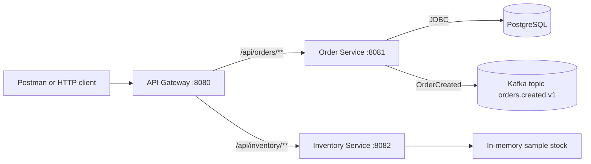

# ShopSphere Backend — Spring Boot Microservices with PostgreSQL and Kafka

**Created by Amit Kumar Ghosh**

ShopSphere Backend is a hands-on Java and Spring Boot learning project for understanding microservices, API gateways, REST APIs, PostgreSQL persistence, Kafka events, request tracing, and production-readiness trade-offs. It includes a runnable API Gateway, Order Service, and Inventory Service, plus a Postman collection for exploring the requests step by step.

> This repository is an educational starter, not a production commerce platform. Some architecture topics are implementation exercises, and the running code has known limitations described below.

## Start here

- **New to the project or Postman?** Follow the [Beginner Run and Postman Guide](docs/13-beginner-run-and-postman-guide.md). It shows setup, exact requests, expected responses, and where to see logs, database rows, and Kafka events.
- **Want the big picture?** Read the [Project Purpose, Concepts, and Production Roadmap](docs/14-project-purpose-concepts-and-production-roadmap.md).
- **Looking for a map of all docs?** Open the [Documentation Index](docs/README.md).
- **Want to contribute?** Read [CONTRIBUTING.md](CONTRIBUTING.md).

## What you can learn and run

- Route HTTP requests through Spring Cloud Gateway to separate Spring Boot services.
- Use `GET` requests to read inventory and orders and `POST` requests to reserve stock or create an order.
- Validate input and return meaningful HTTP status codes.
- Persist order data in PostgreSQL and inspect it with SQL.
- Publish an `OrderCreated` event to Kafka and inspect the topic with a console consumer.
- Follow one request across services using an `X-Correlation-ID` and application logs.
- Study the next steps for JWT/OIDC security, idempotency, transactional outbox, sagas, testing, observability, and deployment.

The project has no storefront or browser UI. Use Postman as the API client and the service logs, PostgreSQL, and Kafka to observe the backend work.

## Architecture at a glance



| Component | Purpose | Local address |
|---|---|---|
| API Gateway | Public entry point; routes API requests to the owning service. | `http://localhost:8080` |
| Order Service | Creates and reads orders; stores them in PostgreSQL and publishes an event to Kafka. | `http://localhost:8081` |
| Inventory Service | Looks up and reserves sample product stock. | `http://localhost:8082` |
| PostgreSQL | Stores order records. | `localhost:5432` |
| Kafka | Carries order-created events. | `localhost:9092` |

This is the **implemented local flow**. The curriculum also describes future services and patterns that are not yet present in the runnable code. See [Current scope and production roadmap](docs/14-project-purpose-concepts-and-production-roadmap.md#current-implementation-and-future-architecture).

## Technology stack

- Java 21 or newer
- Spring Boot 3.4.5
- Spring Cloud Gateway 2024.0.1
- Apache Maven 3.9 or newer
- PostgreSQL 16
- Apache Kafka 3.9.1 in local KRaft mode
- Docker Compose v2
- Postman collection format 2.1

## Quick start

### Prerequisites

Install a Java JDK 21+, Maven 3.9+, Docker Desktop or Docker Engine with Compose v2, and Postman Desktop. Start Docker and wait until its engine is ready. For installation steps on macOS, Windows, and Linux, see [What you need](docs/11-running-and-extending.md#1-what-you-need).

For the default local walkthrough, leave `JWT_ISSUER_URI` unset. The project does not include an identity provider. If you set this variable, the Gateway expects a trusted issuer and valid JWTs.

### Get the source code

After publishing the repository, open its GitHub page, choose **Code**, and copy the HTTPS clone URL. Then run the following, replacing the placeholder with the URL you copied. You can also download the repository as a ZIP and extract it.

```sh
git clone <repository-url>
cd <repository-folder>
```

Run all commands below from the repository root, the folder containing `README.md` and `compose.yaml`.

### 1. Start PostgreSQL and Kafka

```sh
docker compose up -d postgres kafka
docker compose ps
```

Wait until both containers show `healthy`. The first run downloads the database and Kafka images.

### 2. Start the Spring Boot applications

Open **three separate terminals** at the repository root. Run one command in each and leave each process running.

**Inventory Service:**

```sh
mvn -f services/inventory-service/pom.xml spring-boot:run
```

**Order Service:**

```sh
mvn -f services/order-service/pom.xml spring-boot:run
```

**API Gateway:**

```sh
mvn -f gateway/pom.xml spring-boot:run
```

Wait for each terminal to print `Started ...`. The first Maven run downloads dependencies and may take a few minutes.

### 3. Check service health

Open these URLs in a browser or send them as `GET` requests in Postman. Each should return HTTP `200` and `{"status":"UP"}`:

- Gateway: `http://localhost:8080/actuator/health`
- Order Service: `http://localhost:8081/actuator/health`
- Inventory Service: `http://localhost:8082/actuator/health`

### 4. Try the APIs in Postman

Import both files from `postman/`:

1. `shopsphere-local.postman_collection.json`
2. `shopsphere-local.postman_environment.json`

Select the **ShopSphere Local** environment, then open **Collections → ShopSphere Local API**. Run its numbered folders in order. The collection supplies sample URLs, headers, request bodies, and response checks.

For a complete first-time walkthrough, including what to click and how to observe effects in the logs, PostgreSQL, and Kafka, see the [Beginner Run and Postman Guide](docs/13-beginner-run-and-postman-guide.md).

## API examples

All routes below are available through the gateway on port 8080 unless marked **direct**.

| Method | Request | Expected result | Behavior |
|---|---|---:|---|
| `GET` | `/api/inventory/BK-001` | `200 OK` | Reads sample stock through Gateway. |
| `POST` | `/api/inventory/BK-001/reserve?quantity=1` (direct to port 8082) | `200 OK` | Reserves one unit in Inventory Service's in-memory map. |
| `POST` | `/api/orders` | `201 Created` | Creates an order, stores it in PostgreSQL, and publishes `OrderCreated` to Kafka. |
| `GET` | `/api/orders/{id}` | `200 OK` | Retrieves an order from PostgreSQL by ID. |

Create-order JSON body:

```json
{
  "customerId": "customer-123",
  "sku": "BK-001",
  "quantity": 1
}
```

The collection also demonstrates expected error responses: an unknown SKU returns `404`, and invalid quantities return `400`.

## View live request logs

Each service prints logs in its own terminal and writes to a file. From the repository root, open another terminal and run:

```sh
tail -f logs/gateway.log logs/order-service.log logs/inventory-service.log
```

Postman sends an `X-Correlation-ID` with each request. Find it in the response **Headers** and search for the same value in the logs to follow a request through Gateway and its destination service. Logs omit request bodies and credentials.

In Windows PowerShell, open three terminals and run one command in each:

```powershell
Get-Content logs/gateway.log -Wait
```

```powershell
Get-Content logs/order-service.log -Wait
```

```powershell
Get-Content logs/inventory-service.log -Wait
```

## Current scope and limitations

- Inventory stock is held in memory. It resets when Inventory Service restarts and is not shared between service instances.
- Creating an order does **not** reserve inventory. The order and inventory APIs are currently separate flows.
- Order Service writes to PostgreSQL and publishes to Kafka as separate operations. The transactional outbox pattern is a learning task.
- An idempotency-key column and unique index exist, but the API does not replay the original response for a repeated key.
- Kafka receives order-created events, but Inventory Service does not consume them yet.
- There is no running Payment, Notification, Realtime, or Webhook service and no bundled identity provider.
- Local Gateway mode permits requests without a token when `JWT_ISSUER_URI` is empty. The project does not provide complete production authorization.
- The local Compose setup is for learning. It is a single PostgreSQL database and single-node Kafka broker, not a high-availability production deployment.

These boundaries are intentional topics for extension. The [production roadmap](docs/14-project-purpose-concepts-and-production-roadmap.md#production-readiness-what-it-would-take) describes the additional engineering required before serving real users.

## Documentation

| Guide | What it covers |
|---|---|
| [Documentation index](docs/README.md) | All learning paths and docs in one place. |
| [Beginner run and Postman guide](docs/13-beginner-run-and-postman-guide.md) | Setup, Postman steps, expected results, and where to see logs/data. |
| [Project purpose and production roadmap](docs/14-project-purpose-concepts-and-production-roadmap.md) | Why the services exist, concepts taught, current/future scope, and production gaps. |
| [Postman tracing walkthrough](docs/12-postman-and-request-tracing.md) | Presenter script, response checks, correlation IDs, and code tour. |
| [Running and extending](docs/11-running-and-extending.md) | Prerequisites, configuration, project structure, troubleshooting, and extension steps. |
| [Architecture and domain boundaries](docs/01-architecture.md) | Service ownership and communication choices. |
| [Implementation specification](docs/10-implementation-spec.md) | API baseline and full-course acceptance criteria. |
| [Testing, observability, and deployment](docs/07-test-observe-deploy.md) | Test strategy and operating principles. |

## Contributing

Contributions that improve the learning experience are welcome. Start with [CONTRIBUTING.md](CONTRIBUTING.md) for the workflow, code and documentation expectations, and local checks.

## License and reuse

The current [`LICENSE`](LICENSE) file is a notice, not a standard open-source license. No general reuse or redistribution license has been granted in this repository yet. Review the file and obtain permission before redistributing or using the project commercially. The maintainer should choose and add an explicit license before describing the repository as open source.

## Suggested GitHub repository topics

When publishing the repository, add relevant topics in GitHub's repository settings, such as `java`, `spring-boot`, `microservices`, `api-gateway`, `postgresql`, `kafka`, `docker-compose`, `backend`, and `learning-project`. These describe the project for people browsing GitHub; search ranking is not guaranteed.
