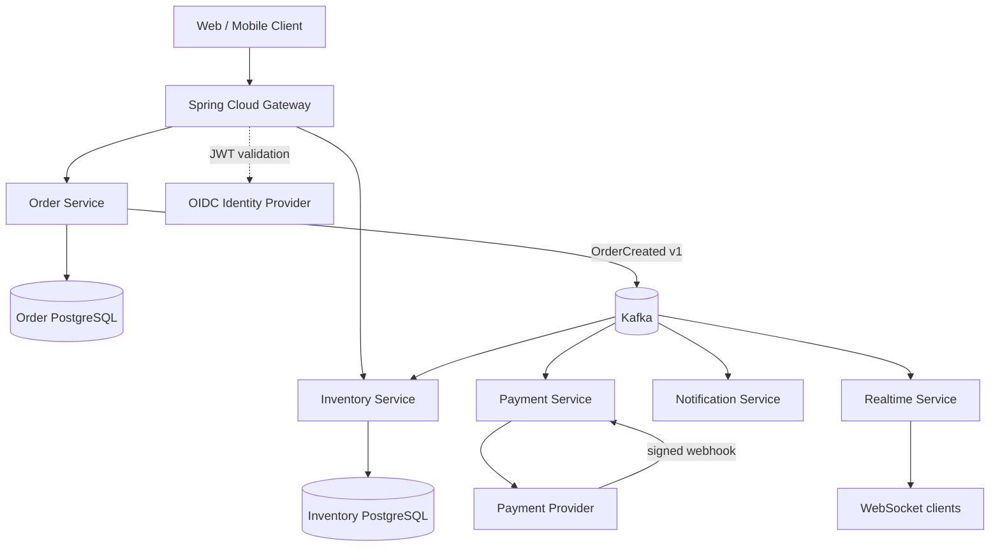

# Architecture and Domain Boundaries

## Ownership
- Order Service owns order lifecycle and customer-order relationship.
- Inventory Service owns stock and reservations.
- Payment Service owns payment attempts, provider references, and refunds.
- Notification Service owns delivery attempts and templates.
- Realtime Service owns authenticated client connections and live fan-out.
- Identity provider authenticates users and issues tokens.

Each service owns its data. Do not use cross-service SQL joins. Use APIs for immediate queries and events for asynchronous state propagation.

## Communication choices
- HTTP: immediate response needed and dependency latency is acceptable.
- Kafka: independent consumers, asynchronous workflows, buffering/replay.
- WebSocket: server pushes live data to a connected client.
- Webhook: external system sends an HTTP callback.

## Evolution
Start as a modular monolith. Extract services when clear ownership, independent scaling, or deployment cadence justifies the added network, operations, and consistency costs. Container DNS is sufficient for local discovery; Eureka is an optional later lab.
