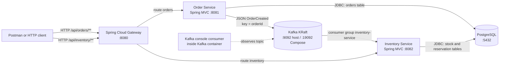

# ShopSphere implementation specification

This document records the implementation boundary and the course acceptance target. Read the **implemented baseline** sections as a description of the code that runs today. Read **course acceptance target** as work students may implement later; these items are not all present in the starter.

## Audience and purpose

This specification is for learners and contributors who need to know which APIs, services, data stores, and event paths exist before they extend the project. It is a source-linked contract for the current local teaching baseline, not a claim of production readiness.

## Technology baseline

| Technology | Version in project | Role |
|---|---:|---|
| Java | 21 | Runtime and language target for all Spring applications. |
| Spring Boot | 3.4.5 | Application framework for Gateway, Order Service, and Inventory Service. |
| Spring Cloud | 2024.0.1 | Spring Cloud Gateway integration. |
| PostgreSQL | 16 Alpine container | Order, inventory stock, and inventory reservation persistence. |
| Apache Kafka | 3.9.1 container | Local KRaft broker for `orders.created.v1`. |
| Maven | 3.9+ recommended | Separate Maven build for each Spring Boot application; there is no root reactor. |
| Postman | Desktop or supported web client | Sends and inspects the local collection requests. |

Check the `pom.xml` files and [compose.yaml](../compose.yaml) for the exact versions. Recheck supported patch versions and platform requirements before choosing production dependencies.

## Implemented architecture



Compose starts PostgreSQL and Kafka only. The three Spring applications run as Maven processes on the host. In local development, both services use the same PostgreSQL container and database, though their schemas are logically separated by service ownership.

### Request and event sequence

```mermaid
sequenceDiagram
  actor Client as Postman
  participant GW as Gateway :8080
  participant OS as Order Service :8081
  participant DB as PostgreSQL
  participant K as Kafka orders.created.v1
  participant IS as Inventory Service :8082
  Client->>GW: POST /api/orders, X-Correlation-ID, JSON
  GW->>OS: Forward /api/orders/** and correlation header
  OS->>DB: Insert PENDING order
  OS->>K: Start async send of OrderCreated keyed by orderId
  OS-->>GW: 201 order response
  GW-->>Client: 201 Created
  K-->>IS: Deliver JSON event
  IS->>DB: Insert reservation once; conditionally decrement stock
  Client->>GW: GET /api/inventory/reservations/{orderId}
  GW->>IS: Forward reservation lookup
  IS-->>Client: RESERVED or REJECTED
```

The order HTTP response does not wait for Inventory Service. Order status is not updated after the reservation because no result event or callback is implemented.

## Implemented service responsibilities and routes

### Gateway, port 8080

Gateway is the HTTP entry point. Its configured route predicates forward:

| Predicate | Destination by default | Purpose |
|---|---|---|
| `/api/orders/**` | `http://localhost:8081` | Routes order API calls to Order Service. |
| `/api/inventory/**` | `http://localhost:8082` | Routes stock and reservation calls to Inventory Service. |

Gateway does not own order or inventory data and contains no business reservation logic. It also logs requests and propagates a safe `X-Correlation-ID`. If `JWT_ISSUER_URI` is blank, local requests are permitted without a bearer token. If it is configured, requests must have a valid JWT from that issuer. The sample does not implement object-level authorization or audience/scope policy.

Each application exposes Spring Boot Actuator `GET /actuator/health`, `GET /actuator/info`, and `GET /actuator/metrics`. The collection checks health directly on each process; Gateway does not proxy the other processes' actuator paths.

### Inventory Service, port 8082

| Method and path | Input | Success response | Important error behavior |
|---|---|---|---|
| `GET /actuator/health` | None | `200`, `{"status":"UP"}` | Process health check. |
| `GET /api/inventory/{sku}` | SKU path value | `200`, `{"sku":"BK-001","available":25}` (count changes as reservations occur) | `404` when SKU is absent. |
| `POST /api/inventory/{sku}/reserve?quantity=1` | Positive integer query parameter; defaults to 1 | `200` with SKU and new available count | `400` for quantity below one; `404` for unknown SKU; `409` if stock is insufficient. |
| `GET /api/inventory/reservations/{orderId}` | Order ID path value | `200` with order ID, SKU, quantity, status, and reason | `404` if no reservation row exists yet or the ID is unknown. |

Order-driven reservation results use `RESERVED` with a null reason, or `REJECTED` with `UNKNOWN_SKU` or `INSUFFICIENT_STOCK`. Inventory stock and reservations are in PostgreSQL. The reservation table's `order_id` primary key makes the database side effect idempotent for repeated delivery of an order ID.

### Order Service, port 8081

| Method and path | Input | Success response | Important error behavior |
|---|---|---|---|
| `GET /actuator/health` | None | `200`, `{"status":"UP"}` | Process health check. |
| `POST /api/orders` | JSON `{ "customerId": "customer-123", "sku": "BK-001", "quantity": 1 }`; optional `Idempotency-Key` header | `201` with generated ID, request fields, status `PENDING`, and `createdAt` | Validation rejects blank customer/SKU or quantity below one with `400`. Spring's default error handler formats the error; no project-wide custom error schema exists. Unknown SKU is not rejected at this service; Inventory Service may reject it later. |
| `GET /api/orders/{id}` | Order ID path value | `200` with stored order fields and current stored status | `404` if the ID does not exist. |

Order Service inserts the row into the `orders` table, then calls `KafkaTemplate.send` for topic `orders.created.v1` with the order ID as key. That send is asynchronous; the controller does not wait for a broker acknowledgement before returning. The event value currently contains `orderId`, `customerId`, `sku`, `quantity`, and `createdAt`. The implementation has an idempotency-key column and unique index, but it does not return the original response for a repeated key.

## HTTP response shapes

### Order created

```json
{
  "id": "<generated-uuid>",
  "customerId": "customer-123",
  "sku": "BK-001",
  "quantity": 1,
  "status": "PENDING",
  "createdAt": "<ISO-8601-timestamp>"
}
```

### Reservation lookup

```json
{
  "orderId": "<order-id-from-create-response>",
  "sku": "BK-001",
  "quantity": 1,
  "status": "RESERVED",
  "reason": null
}
```

For rejection, `status` is `REJECTED` and `reason` is `UNKNOWN_SKU` or `INSUFFICIENT_STOCK`. A `404` when looking up a reservation immediately after order creation can mean the asynchronous listener has not finished yet; look for the consumer log and retry.

## Persistence and event contract

| Table/topic | Owner in application code | Current contents |
|---|---|---|
| `orders` | Order Service | Order ID, customer, SKU, quantity, status, created timestamp, optional idempotency key. |
| `inventory_stock` | Inventory Service | SKU primary key and non-negative available count. Seeded rows are `BK-001` = 25 and `BK-002` = 10, inserted only when absent. |
| `inventory_reservations` | Inventory Service | Unique order ID, SKU, quantity, status, and optional rejection reason. |
| `orders.created.v1` | Order Service producer; Inventory Service consumer | JSON `OrderCreated` records keyed by order ID. |

The current event JSON is:

```json
{
  "orderId": "<order-id>",
  "customerId": "customer-123",
  "sku": "BK-001",
  "quantity": 1,
  "createdAt": "<ISO-8601-timestamp>"
}
```

This is a teaching contract, not a complete versioned production envelope. The current payload has no event ID, event type field, schema version, or separate event registry. The database insert and event send are separate operations; a transactional outbox is not implemented. Since the send acknowledgement is not awaited, a `201` response alone does not prove Kafka durably accepted the event. Confirm delivery in the Kafka viewer and Inventory Service logs.

## Postman collection contract

Import these two files and choose **ShopSphere Local**:

- [`shopsphere-local.postman_collection.json`](../postman/shopsphere-local.postman_collection.json)
- [`shopsphere-local.postman_environment.json`](../postman/shopsphere-local.postman_environment.json)

| Collection folder | Demonstrations |
|---|---|
| `1 - Health checks` | Gateway health, direct Order Service health, direct Inventory Service health. |
| `2 - Inventory flow` | Stock through Gateway, unknown SKU, direct stock reservation, invalid reservation quantity. |
| `3 - Order flow` | Create and read an order, inspect asynchronous reservation and remaining stock, invalid order input, create an unknown-SKU order and inspect its rejection. |

The collection attaches a correlation ID to each request, saves the created `orderId`, and saves `rejectedOrderId` for the rejection demonstration. The environment defines `baseUrl`, `orderServiceUrl`, `inventoryServiceUrl`, `sku`, `unknownSku`, `customerId`, `quantity`, `correlationId`, `idempotencyKey`, `orderId`, and `rejectedOrderId`. Set a 1,000 ms Collection Runner delay for the asynchronous reservation lookup; manual send-after-log is the clearest live teaching sequence. Postman does not automatically sync an imported collection when its JSON file changes.

## Configuration contract

Defaults below describe local host-run Spring applications. Compose uses container service names internally for its own health checks and Kafka listeners.

| Environment variable | Default | Used by |
|---|---|---|
| `DATABASE_URL` | `jdbc:postgresql://localhost:5432/shopsphere` | Order Service and Inventory Service. |
| `DATABASE_USERNAME` | `shopsphere` | Order Service and Inventory Service. |
| `DATABASE_PASSWORD` | `local_dev_only` | Order Service and Inventory Service; local-only credential. |
| `KAFKA_BOOTSTRAP_SERVERS` | `localhost:9092` | Order Service producer and Inventory Service consumer. |
| `KAFKA_AUTO_OFFSET_RESET` | `latest` | Inventory Service; applies when its consumer group has no committed offset. |
| `ORDER_SERVICE_URL` | `http://localhost:8081` | Gateway route destination. |
| `INVENTORY_SERVICE_URL` | `http://localhost:8082` | Gateway route destination. |
| `JWT_ISSUER_URI` | Empty | Gateway security; blank permits local unauthenticated requests. |
| `GATEWAY_LOG_FILE` | `../logs/gateway.log` | Gateway log file path relative to the Gateway module working directory. |
| `ORDER_LOG_FILE` | `../../logs/order-service.log` | Order Service log file path relative to its module working directory. |
| `INVENTORY_LOG_FILE` | `../../logs/inventory-service.log` | Inventory Service log file path relative to its module working directory. |

The root `.env.example` is a template for Compose substitution; a shell-launched Spring process reads the variables exported in its own terminal. The local defaults are for a disposable developer environment only.

## Course acceptance target: future work

These are learning goals, not claims about the current baseline:

1. Return consistent, documented error bodies and status codes.
2. Add concurrency tests for atomic stock reservation, oversell prevention, and transaction rollback.
3. Implement request idempotency replay with payload conflict handling and concurrent requests.
4. Store the order update and outbox record in one transaction.
5. Publish outbox events with bounded retry, observable backlog age, and duplicate-safe processing.
6. Define a versioned event envelope and compatibility policy; add dead-letter and recovery procedures.
7. Publish a reservation result and define order lifecycle transitions, including rejected stock and compensation.
8. Persist saga state if checkout expands to additional services and compensating actions.
9. Add trusted JWT issuer, signature, expiry, audience, and scope validation plus service-level ownership checks.
10. Add signed webhook verification and replay protection if webhook behavior is implemented.
11. Authenticate and scope WebSocket subscriptions if realtime behavior is implemented.
12. Add integration and contract tests with disposable PostgreSQL and Kafka.
13. Document failure experiments, expected signals, and safe recovery for each supported lab.

See [Current implementation and future architecture](14-project-purpose-concepts-and-production-roadmap.md#current-implementation-and-future-architecture) for the production boundary, and [Testing, observability, and deployment](07-test-observe-deploy.md) for the broader operating curriculum.
