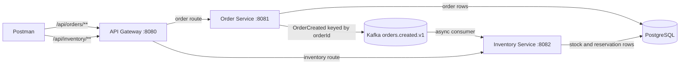

# Postman walkthrough and request tracing

Use this guide to send real requests to ShopSphere, check the expected responses, and follow each request through the API Gateway and its downstream service. The collection gives each HTTP request a correlation ID; Gateway forwards that same ID to the service handling that request. IDs change from one Postman send to the next.

## Before you start

Start PostgreSQL and Kafka, then start all three Spring Boot services. Follow the [running guide](11-running-and-extending.md#4-run-the-three-applications). Confirm the infrastructure is healthy with `docker compose ps`; both `postgres` and `kafka` should show `healthy`.

The Postman collection expects the local API Gateway to run at `http://localhost:8080`, the Order Service at `http://localhost:8081`, and the Inventory Service at `http://localhost:8082`. It assumes `JWT_ISSUER_URI` is unset for local development, which permits requests without a bearer token.

## Request map: which application handles each path



Compose runs PostgreSQL and Kafka; Maven terminals run the three Spring Boot applications. The Gateway performs HTTP routing. Kafka is not the Gateway: it carries the event after Order Service accepts an order. The [Postman folder README](../postman/README.md) lists every request, variable, and expected status. This guide focuses on what each visible result means and how to trace it.

| Postman folder/request | Target | Expected result / evidence |
|---|---|---|
| `1.1` Gateway health | Gateway directly | `200`, `UP`. |
| `1.2` / `1.3` service health | Order / Inventory directly | `200`, `UP`; shows each is a separate process. |
| `2.1` stock through Gateway | Gateway → Inventory | `200`; matching per-request correlation ID in both HTTP logs. |
| `2.2` unknown SKU | Gateway → Inventory | Expected `404`. |
| `2.3` direct reservation | Inventory directly | `200`; durable stock count decreases; no Gateway business-request log. |
| `2.4` invalid reservation | Inventory directly | Expected `400`. |
| `3.1` create order | Gateway → Order | `201`, order `PENDING`; saves `orderId`. Kafka event appears. |
| `3.2` read order | Gateway → Order | `200`; persisted order row. |
| `3.3` reservation | Gateway → Inventory | `200`, `RESERVED` after consumer finishes. |
| `3.4` remaining stock | Gateway → Inventory | `200`; lower stock after successful reservation. |
| `3.5` invalid order | Gateway → Order | Expected `400`; no created order/event. |
| `3.6` unknown-SKU order | Gateway → Order | `201`, `PENDING`; downstream event is then rejected. |
| `3.7` rejection lookup | Gateway → Inventory | `200`, `REJECTED / UNKNOWN_SKU` after consumer finishes. |

## First time using Postman: where to click and what you will see

Postman is the tool you use to send an API request. For this local project, **Postman Desktop** is the simplest option. The backend does not have a web page or shopping UI: a request and its response are shown inside Postman.

### Start the project

If the project is already running, keep it running and skip to **Import the collection and environment** below. Otherwise:

1. Open the project folder in VS Code. It is the folder containing `README.md` and `compose.yaml`.
2. Start Docker Desktop and wait until it says Docker is running.
3. In VS Code, choose **Terminal → New Terminal**. Check the terminal is at the project root, then start the database and message broker:

   ```sh
   docker compose up -d postgres kafka
   docker compose ps
   ```

   Wait until both `postgres` and `kafka` show `healthy`.
4. Open three more VS Code terminals using **Terminal → New Terminal**. In each new terminal, run one command below. Leave all three running; do not close those terminals while demonstrating.

   **Inventory terminal:**

   ```sh
   mvn -f services/inventory-service/pom.xml spring-boot:run
   ```

   **Order terminal:**

   ```sh
   mvn -f services/order-service/pom.xml spring-boot:run
   ```

   **Gateway terminal:**

   ```sh
   mvn -f gateway/pom.xml spring-boot:run
   ```

   Wait until each terminal prints `Started ...`. These terminal windows also show live application logs. Gateway is on port 8080, Order Service on 8081, and Inventory Service on 8082.
5. Open a fifth terminal at the project root to watch requests together:

   ```sh
   tail -f logs/gateway.log logs/order-service.log logs/inventory-service.log
   ```

   Leave it open. If you see `No such file` for `logs/`, wait until the services finish starting; the log files are created at startup. Press `Ctrl+C` only when you want to stop watching the files; this does not stop the services.

### Import the files into Postman

1. Open Postman Desktop. Select **Import** (usually near the top left).
2. Choose **Files**, browse to the project folder, open `postman`, and select `shopsphere-local.postman_collection.json`. Finish the import.
3. Repeat **Import → Files** and select `shopsphere-local.postman_environment.json` from the same folder.
4. In Postman's environment selector near the top right, choose **ShopSphere Local**. If this is not selected, requests containing `{{baseUrl}}` will not have a server address.
5. In the left sidebar, open **Collections**, then **ShopSphere Local API**. Expand a numbered folder and click a request to open it.

### Send your first request and find its response

1. Open **1 - Health checks**, then click **1.1 Gateway health**.
2. Confirm the selected environment at the top right says **ShopSphere Local**.
3. Click the blue **Send** button near the upper right of the request editor.
4. Look below the request editor for the response panel. Its status should read **200 OK**. Select **Body** to see `{"status":"UP"}`. Select **Headers** to inspect response headers. Select **Test Results** to see the collection's automatic checks.
5. Repeat for **1.2 Order Service health** and **1.3 Inventory Service health**. Each should show **200 OK** and `{"status":"UP"}`.

The collection has the URLs, methods, headers, example JSON bodies, and checks already filled in. For the usual walkthrough, you do not need to type request data yourself. To see what the create-order request sends, click **3 - Order flow → 3.1 Create order through Gateway**, then choose **Body** in the request editor. It uses values from the environment, equivalent to:

```json
{
  "customerId": "customer-123",
  "sku": "BK-001",
  "quantity": 1
}
```

If you make a request manually instead of using the collection, replace those example values with your own non-empty customer ID, a known SKU (`BK-001` or `BK-002`), and a positive whole-number quantity. No bearer token is needed in the default local setup.

### Where each visible change appears

| What you do | What changes or appears | Where to see it |
|---|---|---|
| Send a request | Status and JSON response | Postman's response panel under **Body**; status is above the response tabs. |
| Look up `BK-001` | Current stored count; 25 only when the SKU is seeded in a fresh database | Postman response **Body**. |
| Reserve one unit | PostgreSQL available stock drops by one | Reservation response, then a second stock lookup. The change survives service restarts. |
| Create an order | A new order ID and `PENDING` response | Postman's response **Body**; the collection saves the ID as the environment variable `orderId`. |
| Retrieve that order | The saved order fields read back | Send **3.2 Get created order through Gateway**; inspect response **Body**. |
| Save an order | A durable row in PostgreSQL | Run the read-only SQL query in the presenter walkthrough; this is not a graphical database screen. |
| Publish an order event | A JSON `OrderCreated` message | Start the Kafka consumer in the presenter walkthrough before clicking **3.1 Create order**. |
| Process a request | Start/completion log lines with method, path, status, time, and correlation ID | VS Code's three service terminals or the files under the project's `logs/` folder. |

To find the log files in VS Code, use the Explorer on the left, expand the project root, then open `logs/gateway.log`, `logs/order-service.log`, or `logs/inventory-service.log`. The files show a snapshot when opened. For lines to appear live as requests arrive, use the `tail -f` command above in a terminal. Match the Postman response's **Headers → X-Correlation-ID** value with the ID in the log lines.

## Import the collection and environment

1. Open Postman Desktop or the Postman web app.
2. Select **Import**.
3. Import [`postman/shopsphere-local.postman_collection.json`](../postman/shopsphere-local.postman_collection.json).
4. Select **Import** again and import [`postman/shopsphere-local.postman_environment.json`](../postman/shopsphere-local.postman_environment.json).
5. In the environment selector at the top right, select **ShopSphere Local**.
6. Open the environment's variables and confirm `baseUrl`, `orderServiceUrl`, and `inventoryServiceUrl` point at the local ports above. Save changes if you edit them.
7. Open the **ShopSphere Local API** collection. Its folders are numbered in the recommended run order.

The environment contains the sample SKU (`BK-001`), customer ID, quantity, URLs, and variables for the generated correlation ID, idempotency key, and created order ID. The collection's pre-request script generates a fresh correlation ID before each request. The order creation request also generates a fresh idempotency key.

## Presenter walkthrough: see a request become real data

**Time:** about 10–15 minutes. **Goal:** demonstrate routing, stock reads and reservations, order validation, PostgreSQL persistence, Kafka events, and request logs. This starter has no graphical storefront: use Postman as the client, the three log files as the live execution view, and PostgreSQL/Kafka to inspect the effects.

### Prepare the screens

1. Start the services using the [running guide](11-running-and-extending.md#4-run-the-three-applications). Keep the terminals open.
2. Open a separate terminal at the repository root and run:

   ```sh
   tail -f logs/gateway.log logs/order-service.log logs/inventory-service.log
   ```

   Arrange this terminal and Postman so both are visible. Every Postman request gets a fresh correlation ID. Point out how the same ID appears in the gateway and destination service logs.
3. In Postman, select **ShopSphere Local**. Open **1 - Health checks** and send all three requests. Each should return HTTP 200 with `{"status":"UP"}`. This confirms each process is reachable before the demo begins.

### Demo A: route a stock lookup through the gateway

1. In **2 - Inventory flow**, send **2.1 Get stock through Gateway**.
2. Show the response: HTTP 200, `sku` equal to `BK-001`, and `available` equal to the current count (25 after a fresh Inventory Service start).
3. Open response **Headers** and point to `X-Correlation-ID`. Find that exact value in the live logs: the gateway logs the request, forwards it, and Inventory Service logs its own handling of it.

**Explain:** Postman is the client. The gateway is the public entry point and routes `/api/inventory/**` to Inventory Service on port 8082. The service reads its stock from PostgreSQL and returns JSON. The correlation ID is a request-tracing value that ties the separate log records together; it is not an order ID or a security token.

### Demo B: change inventory and see the result

1. Send **2.3 Reserve stock directly** once. It calls Inventory Service on port 8082 with `quantity=1`; expect HTTP 200 and an `available` value one lower than before.
2. Send **2.1 Get stock through Gateway** again. It should now report that lower value, while its logs again appear in both Gateway and Inventory Service.
3. Optionally send **2.4 Invalid reservation quantity returns 400** to show input validation, then **2.2 Unknown SKU returns 404** to show missing-resource handling. The collection's tests count these expected error statuses as successful checks.

**Explain:** this endpoint performs an atomic conditional update in PostgreSQL. On a fresh database, BK-001 starts at 25 and BK-002 at 10. A successful reservation subtracts stock and survives service restarts. A zero or negative quantity is rejected with 400, and an unknown SKU returns 404.

### Demo C: create an order and inspect PostgreSQL and Kafka

1. To watch Kafka live, open another terminal at the repository root and start this consumer **before** creating an order:

   ```sh
   docker compose exec kafka /opt/kafka/bin/kafka-console-consumer.sh --bootstrap-server kafka:19092 --topic orders.created.v1 --from-beginning
   ```

   If the topic has been used before, earlier messages may print first. A new `OrderCreated` event should appear when the new order is submitted. Stop the consumer with `Ctrl+C` when finished.
2. In Postman, open **3 - Order flow** and send **3.1 Create order through Gateway**. Expect HTTP 201 and a response containing a generated `id`, `customerId`, `sku`, `quantity`, status `PENDING`, and `createdAt`. Postman saves the ID in the selected environment as `orderId`.
3. Show the gateway and Order Service log lines carrying the response's correlation ID. They represent two processes handling the same HTTP request.
4. Send **3.2 Get created order through Gateway**. It uses the saved `orderId`; expect HTTP 200 and the same order details. This GET reads the order back from PostgreSQL.
5. To inspect stored rows directly, run:

   ```sh
   docker compose exec postgres psql -U shopsphere -d shopsphere -c "SELECT id, customer_id, sku, quantity, status, created_at FROM orders ORDER BY created_at DESC LIMIT 5;"
   ```

   The row for the latest order should match the `id` and fields returned by Postman. The Kafka consumer should show a JSON event with the same order ID and customer/SKU/quantity fields.
6. Wait for the Inventory Service consumer log, then send **3.3 Check reservation through Gateway** and **3.4 Check remaining stock through Gateway**. For downstream rejection, use **3.6** and **3.7**. **3.5 Invalid order quantity returns 400** shows validation before persistence.

**Explain:** Order Service validates the JSON, writes the order row to PostgreSQL, and publishes `OrderCreated` to `orders.created.v1`. Inventory Service consumes it, atomically reserves stock, and stores an idempotent reservation. The gateway routes order and inventory paths to their owning services. Database insert and Kafka publication remain separate operations (a dual-write flaw); the transactional outbox is a later extension topic.

**Next:** send **3.3 Check reservation through Gateway** and **3.4 Check remaining stock through Gateway** after the Inventory Service consumer log appears. The order endpoint returns before this asynchronous work completes, so an immediate reservation lookup can return 404; wait for the log and retry.

### Quick explanation of the concepts shown

| Concept | What to point at | Plain-language explanation |
|---|---|---|
| API gateway | Port 8080 and `component=gateway` log line | One front door routes a request to the service that owns that API. |
| Microservice boundary | `component=orders` or `component=inventory` log line | Each service owns a focused set of behavior and exposes its own HTTP API. |
| REST and HTTP status | Method, URL, response body, and 200/201/400/404 | Clients ask for a resource or action over HTTP; status codes tell them whether it worked. |
| Validation | The invalid-quantity requests | Reject bad input at the API boundary before changing application data. |
| Persistence | Postman order ID and the PostgreSQL query result | An order row survives an Order Service restart because it is stored in PostgreSQL. |
| Event messaging | Kafka consumer output on `orders.created.v1` | A service can publish a fact so other consumers can react without being called in the same HTTP request. |
| Correlation ID | Same `X-Correlation-ID` in response and service logs | A label connects log records from the separate components that handled one request. |
| Asynchronous event handling | Inventory log shows a reservation after order creation | Kafka decouples order acceptance from inventory processing; inspect the reservation endpoint and PostgreSQL. |

### Where to open the code while presenting

Open these files in your IDE before the demo so you can move from a request to the code that handles it:

| Demo moment | File to show | What to point out |
|---|---|---|
| Gateway receives and routes | [`gateway/src/main/resources/application.yml`](../gateway/src/main/resources/application.yml) | Route predicates and the Order/Inventory destination URLs. |
| Correlation ID and gateway logs | [`RequestLoggingWebFilter.java`](../gateway/src/main/java/com/shopsphere/gateway/RequestLoggingWebFilter.java) | Reads or creates the ID, forwards it, returns it, and logs request timing. |
| Stock lookup and reservation | [`InventoryController.java`](../services/inventory-service/src/main/java/com/shopsphere/inventory/InventoryController.java) | `getStock` reads PostgreSQL; `reserve` atomically updates stock and `reserveForOrder` deduplicates by order ID. |
| Order event consumer | [`OrderCreatedListener.java`](../services/inventory-service/src/main/java/com/shopsphere/inventory/OrderCreatedListener.java) | Reads the Kafka JSON, asks inventory to reserve, and logs the outcome. |
| Order creation and retrieval | [`OrderController.java`](../services/order-service/src/main/java/com/shopsphere/orders/OrderController.java) | `create` validates, inserts with JDBC, and sends a Kafka event; `get` reads the row back. |
| Order table | [`schema.sql`](../services/order-service/src/main/resources/schema.sql) | PostgreSQL columns, quantity constraint, and idempotency-key index. |
| Local database and broker | [`compose.yaml`](../compose.yaml) | PostgreSQL and Kafka containers, ports, health checks, and local broker listeners. |

The response/logging sequence is easier to follow when you keep Postman, the log terminal, and the relevant source file visible. For example, send the stock request, show the gateway route, then `InventoryController.getStock`, then the matching log ID.

### Presenter closing checkpoint

Finish by showing the order row, Kafka event, reservation row, reduced stock, and logs from all services. Reservation is asynchronous; the order remains PENDING because no result event updates its status. The order insert and event publish remain a non-atomic dual write.

## Run the walkthrough one request at a time

Click **Send** for each request and check both its HTTP status and the **Test Results** tab.

### 1. Check service health

Open **1 - Health checks** and run these in order:

| Request | Expected result | What it checks |
|---|---|---|
| `1.1 Gateway health` | HTTP 200 and `{"status":"UP"}` | The gateway process accepts requests. |
| `1.2 Order Service health` | HTTP 200 and `{"status":"UP"}` | Order Service responds directly. |
| `1.3 Inventory Service health` | HTTP 200 and `{"status":"UP"}` | Inventory Service responds directly. |

If any request fails, stop here and use the troubleshooting section below. The Postman **Console** also shows connection errors and script output.

### 2. Try inventory requests

Open **2 - Inventory flow** and run the requests in order:

1. **`2.1 Get stock through Gateway`** sends `GET /api/inventory/BK-001` to port 8080. Expect HTTP 200 with a body like `{"sku":"BK-001","available":25}`. The test checks the SKU, numeric stock count, and returned correlation ID. This request should appear in both Gateway and Inventory Service logs.
2. **`2.2 Unknown SKU returns 404`** sends a lookup for `NO-SUCH-SKU`. Expect HTTP 404. This is a deliberate error-path check; Postman marks the test as passed when the service returns the expected 404.
3. **`2.3 Reserve stock directly`** sends `POST /api/inventory/BK-001/reserve?quantity=1` directly to port 8082. Expect HTTP 200 and a numeric `available` value. This changes stock in PostgreSQL, so each successful run lowers the count. Restarting Inventory Service does not restore stock.
4. **`2.4 Invalid reservation quantity returns 400`** sends a reservation with quantity zero. Expect HTTP 400 because quantities must be positive.

### 3. Create, then retrieve an order

Run the requests in **3 - Order flow** in order:

1. **`3.1 Create order through Gateway`** sends a JSON request to `POST /api/orders` through port 8080. Expect HTTP 201 and a JSON response with an order ID and status `PENDING`. A Postman test saves the response ID into the selected environment's `orderId` variable. The request uses a new idempotency key every time it runs.
2. **`3.2 Get created order through Gateway`** sends `GET /api/orders/{{orderId}}`. Expect HTTP 200 and the order details. It checks that the ID, customer ID, and SKU match the order you created.
3. **`3.3 Check reservation through Gateway`** reads the result after Kafka consumption; wait for the listener log if necessary. **`3.4 Check remaining stock through Gateway`** shows the updated count.
4. **`3.5 Invalid order quantity returns 400`** sends quantity zero and expects HTTP 400.
5. **`3.6` and `3.7`** demonstrate that an accepted order can lead to a rejected inventory reservation for an unknown SKU.

If you run `3.2` before `3.1`, `orderId` is empty and the lookup will fail. Create a fresh order first, then run the lookup again.

## Run the whole collection

After confirming the environment is selected, select the collection's **Run** option to open Collection Runner. Run folders in numerical order. Set a **1,000 ms delay** between requests so the asynchronous Inventory Service consumer can process an order before the reservation lookup. The health checks run first; the order folder creates and stores an order ID before fetching and checking its reservation. Review the final test summary for any failed assertions.

Direct and order-driven reservations change durable stock each time. Repeated collection runs will continue to reduce availability. The invalid requests are expected to return 404 or 400; those status codes count as passing checks because the tests assert the expected behavior. The unknown-SKU order is accepted first, then its reservation is recorded as rejected.

## Follow a request through the logs

Each request sends an `X-Correlation-ID` header. The Gateway keeps a valid ID or creates one, forwards it to the selected service, and returns it in the response header. Both services also return the header for direct requests.

In Postman, select a request, send it, and open the **Headers** section of the response. Copy the `X-Correlation-ID` value. Search for that value in the running application terminals. You should see log entries in this form:

```text
http request started component=gateway correlationId=... method=GET path=/api/inventory/BK-001
http request completed component=gateway correlationId=... method=GET path=/api/inventory/BK-001 status=200 durationMs=...
http request started component=inventory correlationId=... method=GET path=/api/inventory/BK-001
http request completed component=inventory correlationId=... method=GET path=/api/inventory/BK-001 status=200 durationMs=... outcome=completed
```

For an order request, look for `component=gateway` and `component=orders`. The same correlation ID connects the log entries. The start line shows when a component receives the request; the completion line shows its HTTP status and elapsed time in milliseconds.

The logs include the component name, correlation ID, HTTP method, URL path, status, and duration. They intentionally omit request bodies, query values, authorization headers, and other credentials. The raw ID is limited to a safe 64-character set before it is logged.

The HTTP correlation ID applies to one HTTP request through Gateway and its destination service. The current `OrderCreated` Kafka payload does not contain that header. When you follow asynchronous work, use the `orderId` across the create response, Kafka message, Inventory Service consumer log, and reservation lookup. This distinction prevents expecting the HTTP correlation ID in the event consumer log.

Each service also writes a log file in the repository's `logs/` directory:

| Log file | Contains |
|---|---|
| `logs/gateway.log` | Requests received by the API Gateway, including routed and health requests. |
| `logs/order-service.log` | Requests received directly by Order Service or forwarded from the gateway. |
| `logs/inventory-service.log` | Requests received directly by Inventory Service or forwarded from the gateway. |

From the repository root on macOS or Linux, follow all three files in one terminal:

```sh
tail -f logs/gateway.log logs/order-service.log logs/inventory-service.log
```

On PowerShell, open three terminals and follow one file in each:

```powershell
Get-Content logs/gateway.log -Wait
```

```powershell
Get-Content logs/order-service.log -Wait
```

```powershell
Get-Content logs/inventory-service.log -Wait
```

The `logs/` directory is created when the services start and is excluded from version control. If you change where logs are written, use `GATEWAY_LOG_FILE`, `ORDER_LOG_FILE`, or `INVENTORY_LOG_FILE` in the corresponding service's environment.

### View logs in VS Code terminals

To watch the console output directly in VS Code, start each service in its own integrated terminal from the repository root:

```sh
mvn -f services/inventory-service/pom.xml spring-boot:run
```

```sh
mvn -f services/order-service/pom.xml spring-boot:run
```

```sh
mvn -f gateway/pom.xml spring-boot:run
```

Keep those terminals open while sending Postman requests. The same log entries are written to the files above, so you can instead follow the files from VS Code's integrated terminal. If the services are already running on ports 8080–8082, stop the existing processes before starting another copy; otherwise Spring Boot will report that the port is in use. Stop a service with `Ctrl+C` in its terminal. You can search console output or log files using the correlation ID.

## What each request exercises

| Component | Example | Behavior |
|---|---|---|
| API Gateway | `GET /api/inventory/BK-001` | Receives the public request and routes it to Inventory Service. |
| Inventory Service | `GET /api/inventory/BK-001` | Reads stock from PostgreSQL. |
| Inventory Service | `POST /api/inventory/BK-001/reserve?quantity=1` | Atomically decrements stock in PostgreSQL. |
| Order Service | `POST /api/orders` | Validates input, inserts an order in PostgreSQL, then publishes `OrderCreated` to Kafka. |
| Order Service | `GET /api/orders/{id}` | Reads an order from PostgreSQL. |
| Inventory Service | `GET /api/inventory/reservations/{orderId}` | Reads the asynchronous reservation result by order ID. |

The current Order Service performs its PostgreSQL write and Kafka send as separate operations. The outbox pattern is a learning task, not yet implemented. The idempotency-key database column is present, but response replay is not implemented; Postman creates unique keys so the normal order walkthrough succeeds on repeated runs.

## Troubleshooting

### Postman says it cannot connect

Confirm Docker is running and both Compose services are healthy, then check that the three Spring Boot applications are running. Open the three health URLs directly or run folder **1 - Health checks**. Verify Postman has the **ShopSphere Local** environment selected and its base URLs are correct.

### Gateway health works but a routed request returns a connection error

The gateway is running, but its destination service may be stopped. Check Order Service on port 8081 and Inventory Service on port 8082. Review the corresponding service terminal for startup errors.

### A request returns 401 or 403

For local mode, start the Gateway with `JWT_ISSUER_URI` unset or empty. If a trusted JWT issuer is configured, the gateway requires a valid bearer token. The sample project does not include an identity provider or token.

### Order creation returns 500

Check PostgreSQL and Kafka health and review the Order Service log. If you manually reused an idempotency key, choose a new key: the unique database index exists, but the starter does not replay the earlier response for repeated keys.

### Order creation returns 201 but the Kafka event or reservation is missing

The create endpoint sends the event asynchronously and does not wait for Kafka acknowledgement. Check the Order Service log and Kafka health, confirm the console consumer is reading `orders.created.v1`, and check Inventory Service logs. This is the current database/Kafka dual-write limitation; the transactional outbox is a future exercise.

### Reservation lookup returns 404 immediately after order creation

The HTTP request can finish before the Inventory Service listener processes the Kafka message. Search `logs/inventory-service.log` for `event=OrderCreated` and the matching `orderId`; send **3.3** again after that line appears.

### The order request returns 201 but fetching it returns 404

Confirm that the URL uses the order ID from the latest create response. In Postman, check that `orderId` was saved in the selected **ShopSphere Local** environment after request `3.1` completed.

### Postman shows a failed test for an expected 400 or 404

Check that you sent the request from the imported collection rather than a hand-written request with a different script or URL. The unknown SKU, invalid reservation, and invalid order requests intentionally return 404 or 400; their tests should pass when those status codes are returned.

## Files used in this walkthrough

- [`shopsphere-local.postman_collection.json`](../postman/shopsphere-local.postman_collection.json): requests, ordering, correlation header, and response assertions.
- [`shopsphere-local.postman_environment.json`](../postman/shopsphere-local.postman_environment.json): local URLs and sample values.
- [`shopsphere-local.http`](../postman/shopsphere-local.http): compact examples for editors that support HTTP request files.
- [`RequestLoggingWebFilter.java`](../gateway/src/main/java/com/shopsphere/gateway/RequestLoggingWebFilter.java): gateway request logging and correlation propagation.
- [`RequestLoggingFilter.java`](../services/inventory-service/src/main/java/com/shopsphere/inventory/RequestLoggingFilter.java): inventory request logging.
- [`RequestLoggingFilter.java`](../services/order-service/src/main/java/com/shopsphere/orders/RequestLoggingFilter.java): order request logging.
- `logging.file.name` in the three `application.yml` files: paths for the console plus rolling service log files.
