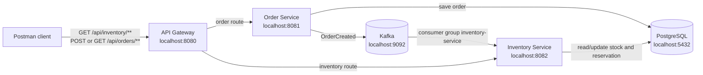

# ShopSphere beginner guide: run the services and use Postman

This guide is for someone new to Postman and Spring Boot. It explains how to start ShopSphere, which Postman method to choose, what values to send, where the response appears, where to watch logs, and how to confirm an order was saved and published.

> **Important:** ShopSphere is a backend learning project. It does not include a web shop or visual user interface. Postman acts as the client: you send an HTTP request and inspect the response. The services and data changes are visible in VS Code terminals, log files, PostgreSQL, and Kafka.

## One picture before you start

The Spring Boot applications are separate processes that you start in separate terminals. Docker Compose starts only PostgreSQL and Kafka. Postman sends the HTTP request to Gateway, and Gateway forwards it to the service that owns the route. Order Service communicates with Inventory Service asynchronously through Kafka.



This diagram represents the local setup. Database tables are logically owned by services, but the learning setup uses one PostgreSQL database instance. The post-create response is `PENDING`; wait for Inventory Service to consume Kafka before checking its reservation.

For the complete source tree, configuration, architecture, and extension notes, see [Running and extending ShopSphere](11-running-and-extending.md). For extra Postman response assertions and the presenter script, see [Postman walkthrough and request tracing](12-postman-and-request-tracing.md).

## 1. Tools you need

Install these before starting:

| Tool | Why it is needed | Check it in a terminal |
|---|---|---|
| Java JDK 21 or newer | Runs the Spring Boot applications | `java -version` |
| Maven 3.9 or newer | Builds and starts the Java applications | `mvn -version` |
| Docker Desktop or Docker Engine with Compose v2 | Runs PostgreSQL and Kafka | `docker compose version` and `docker info` |
| Postman Desktop | Sends requests to the local API | Install from [Postman's official download page](https://www.postman.com/downloads/) and open it |
| VS Code or another IDE (recommended) | Opens the source code and provides terminals | Open the repository folder |

If Java, Maven, or Docker are not installed, follow the operating-system-specific instructions in [the running guide](11-running-and-extending.md#1-what-you-need) first. You can download the repository as a ZIP or clone it with Git. All commands in this guide must be run from the repository root: the folder containing `README.md`, `compose.yaml`, `gateway/`, and `services/`.

Open that folder in VS Code. Choose **Terminal → New Terminal**. Confirm that the prompt is at the project root. If needed, change to the folder with `cd <path-to-shopsphere-backend>`.

## 2. Start the database and message broker

Start Docker Desktop and wait for it to say Docker is running. In a VS Code terminal at the project root, run:

```sh
docker compose up -d postgres kafka
docker compose ps
```

The first command starts PostgreSQL and Kafka in the background. The second lists their state. Wait until both services show `healthy` before continuing. On first startup Docker may need to download the container images.

These are the infrastructure dependencies:

| Dependency | Local address | Used for |
|---|---|---|
| PostgreSQL | `localhost:5432` | Stores orders, seeded inventory stock, and order reservation results in the local setup. |
| Kafka | `localhost:9092` | Carries order-created events. |

Compose starts only the database and broker. It does **not** start the three Spring Boot applications.

## 3. Start all three Spring Boot applications

Open three additional VS Code terminals from **Terminal → New Terminal**. Run one command in each terminal from the repository root. Leave all three terminals open; closing a terminal or pressing `Ctrl+C` stops its application.

**Terminal A — Inventory Service:**

```sh
mvn -f services/inventory-service/pom.xml spring-boot:run
```

It listens on `http://localhost:8082` and serves inventory lookups and reservations.

**Terminal B — Order Service:**

```sh
mvn -f services/order-service/pom.xml spring-boot:run
```

It listens on `http://localhost:8081`, connects to PostgreSQL, and publishes order events to Kafka.

**Terminal C — API Gateway:**

```sh
mvn -f gateway/pom.xml spring-boot:run
```

It listens on `http://localhost:8080` and routes client requests to the appropriate service.

Wait until each terminal prints a line containing `Started ...`. The first run can take longer while Maven downloads dependencies. If a service reports that a port is already in use, another copy may already be running; do not start a second copy on the same port.

### What each application does

| Application | Port | Main responsibility |
|---|---:|---|
| API Gateway | 8080 | The public entry point. Routes order requests to port 8081 and inventory requests to port 8082. |
| Order Service | 8081 | Validates order requests, writes orders to PostgreSQL, publishes Kafka events, and reads orders back. |
| Inventory Service | 8082 | Reads PostgreSQL stock and consumes order-created Kafka events to reserve it. |

The gateway is a separate Spring Boot application using Spring Cloud Gateway. Order and Inventory are also Spring Boot applications. This project uses a **microservice** layout: each service runs as a separate process and owns its own API behavior.

## 4. Open the Postman requests

Use Postman Desktop for the simplest connection to services on your computer.

1. In Postman, click **Import** (some layouts show **Use resources → Import**).
2. Choose **Files**. Browse into the repository's `postman/` folder and import `shopsphere-local.postman_collection.json`.
3. Click **Import** again and import `shopsphere-local.postman_environment.json` from the same folder.
4. In the environment selector near the top right, choose **ShopSphere Local**.
5. In the left sidebar, choose **Collections → ShopSphere Local API**. Expand the folders to see the individual requests.

The environment supplies the local URLs and sample values. The collection already includes request methods, headers, example request bodies, correlation IDs, and response checks. For the guided run, you normally do not need to type any data.

**When the collection file changes:** Postman does not automatically refresh workspace collections from disk. Import `postman/shopsphere-local.postman_collection.json` again. If Postman offers to update or replace the existing **ShopSphere Local API**, choose that option. If it creates a second copy, open the newly imported collection and confirm it contains requests **3.3** through **3.7**; use that copy for this walkthrough. The environment file only needs to be imported once unless its values have changed.

The important environment values are:

| Variable | Default value | Purpose |
|---|---|---|
| `baseUrl` | `http://localhost:8080` | API Gateway URL. |
| `orderServiceUrl` | `http://localhost:8081` | Direct Order Service URL for its health check. |
| `inventoryServiceUrl` | `http://localhost:8082` | Direct Inventory Service URL for comparing direct calls with Gateway routing. |
| `sku` | `BK-001` | Sample inventory item. |
| `customerId` | `customer-123` | Sample customer on order creation. |
| `quantity` | `1` | Units to reserve or order. |
| `orderId` | blank until an order is created | Filled in automatically by the create-order request. |

## 5. Postman basics: method, URL, body, and response

An HTTP request has a **method** (what kind of action), a **URL** (which address), optional **headers** (request metadata), and sometimes a **body** (data being sent).

| Postman method | Meaning in this demo | Example |
|---|---|---|
| `GET` | Read information. It should not change the sample data. | Look up stock or fetch an order. |
| `POST` | Submit data or ask the service to perform an action. | Create an order or reserve inventory. |

To run one imported request:

1. Click its name in the collection. The request editor opens.
2. Check the method selector to the left of the URL. The collection has already selected `GET` or `POST` correctly.
3. Check the URL. Values such as `{{baseUrl}}` are filled from the selected environment.
4. For a POST request, click the request editor's **Body** tab to see the JSON/query values. The collection fills those in.
5. Click **Send**.
6. Look below the editor. The response status appears above the response tabs. Click **Body** to see returned JSON, **Headers** to see response headers such as `X-Correlation-ID`, or **Test Results** to see automatic checks.

`200 OK` means a request succeeded. `201 Created` means a new order was created. `400 Bad Request` means the input was invalid. `404 Not Found` means the requested SKU or order does not exist. In this collection, the expected 400 and 404 responses are intentional demonstrations; Postman should show their test as passing.

## 6. Run the requests in order

### Step 1 — Check all three applications

Open **1 - Health checks** and click each request, then **Send**:

| Request | What it calls | Expected response |
|---|---|---|
| `1.1 Gateway health` | `GET http://localhost:8080/actuator/health` | `200 OK`, body `{"status":"UP"}` |
| `1.2 Order Service health` | `GET http://localhost:8081/actuator/health` | `200 OK`, body `{"status":"UP"}` |
| `1.3 Inventory Service health` | `GET http://localhost:8082/actuator/health` | `200 OK`, body `{"status":"UP"}` |

If health checks fail, do not continue. Confirm the three applications are still running in their terminals and the infrastructure containers are healthy.

### Step 2 — Read inventory through the gateway (`GET`)

Open **2 - Inventory flow → 2.1 Get stock through Gateway** and click **Send**.

- **Method:** `GET` — reads stock.
- **URL:** `http://localhost:8080/api/inventory/BK-001` after Postman fills in `{{baseUrl}}` and `{{sku}}`.
- **Expected:** `200 OK`; body similar to `{"sku":"BK-001","available":25}` after a fresh Inventory Service start.
- **Where the code runs:** the request reaches Gateway on port 8080, then Gateway routes it to Inventory Service on 8082.

In the response panel, click **Headers** and find `X-Correlation-ID`. The same value should appear in gateway and inventory service logs. This value helps connect logs from the same request.

### Step 3 — Reserve one unit (`POST`) and see stock change

Open **2 - Inventory flow → 2.3 Reserve stock directly** and click **Send**.

- **Method:** `POST` — asks Inventory Service to reserve persisted stock.
- **URL:** `http://localhost:8082/api/inventory/BK-001/reserve?quantity=1`.
- **Expected:** `200 OK`; body contains `sku` and `available` reduced by one (normally 24 if a fresh database was seeded at 25 immediately before this request).
- This request goes directly to Inventory Service, so there should be an inventory log entry and no gateway log entry for this specific request.

Now send **2.1 Get stock through Gateway** again. The body should show the new, lower stock count. This is the visible “change” in the demo. Stock is stored in PostgreSQL, so it survives an Inventory Service restart. The sample values 25 for `BK-001` and 10 for `BK-002` seed a fresh database only.

Two useful error examples:

| Request | What to send | Expected | Meaning |
|---|---|---:|---|
| `2.2 Unknown SKU returns 404` | `GET` for `NO-SUCH-SKU` via gateway | 404 | Inventory Service has no such item. |
| `2.4 Invalid reservation quantity returns 400` | `POST` reserve with quantity `0` | 400 | The service rejects a quantity less than one. |

### Step 4 — Create an order (`POST`)

Before creating an order, you can start a Kafka viewer in a new terminal (optional, but useful for a demonstration):

```sh
docker compose exec kafka /opt/kafka/bin/kafka-console-consumer.sh --bootstrap-server kafka:19092 --topic orders.created.v1 --from-beginning
```

Leave it running. It prints order events; earlier events may appear first. Press `Ctrl+C` to stop the viewer after the demo.

In Postman, open **3 - Order flow → 3.1 Create order through Gateway**. Click its **Body** tab to see what is submitted:

```json
{
  "customerId": "customer-123",
  "sku": "BK-001",
  "quantity": 1
}
```

The imported collection fills these values in using the selected environment. Click **Send**.

- **Method:** `POST` — sends order information for creation.
- **URL:** `http://localhost:8080/api/orders`.
- **Header:** `Content-Type: application/json`; the collection also supplies a fresh `Idempotency-Key` and `X-Correlation-ID`.
- **Expected:** `201 Created`; response JSON contains a generated `id`, `customerId`, `sku`, `quantity`, `status: "PENDING"`, and `createdAt`.
- The response's `id` is saved automatically as the Postman environment variable `orderId`.
- The request goes to Gateway, which routes it to Order Service on port 8081.

Order Service calls Kafka's asynchronous send method but does not wait for a broker acknowledgement. A `201` confirms the order record was created; confirm the event separately in the Kafka viewer and Inventory Service log. The database insert and event send are not one transaction in this teaching baseline.

### Step 5 — Read the new order back (`GET`)

Open **3 - Order flow → 3.2 Get created order through Gateway**, then click **Send**.

- **Method:** `GET` — reads the order without creating another one.
- **URL:** `http://localhost:8080/api/orders/{{orderId}}`. Postman substitutes the ID saved by step 4.
- **Expected:** `200 OK`; the returned ID, customer ID, SKU, quantity, and status should match the create response.

Always create the order before running this request. If `orderId` is blank, Postman has no order ID to insert into the URL.

### Step 6 — Check the asynchronous inventory reservation

After the Inventory Service terminal or `logs/inventory-service.log` shows `event=OrderCreated` for this order ID, send **3.3 Check reservation through Gateway**. Expect `200 OK` and `status: RESERVED`. Then send **3.4 Check remaining stock through Gateway**; the available count should be reduced by the order quantity. If you send the reservation lookup before the event is processed, it can return 404; wait for the consumer log and retry.

For a downstream failure demonstration, send **3.6 Create order for unknown SKU**, wait for the Inventory Service `REJECTED` log, then send **3.7 Check rejected reservation through Gateway**. It should show `REJECTED` and `UNKNOWN_SKU`. The order still returns `PENDING`, because this demo does not send a result event back to Order Service.

The invalid order example **3.5 Invalid order quantity returns 400** sends a POST with quantity `0`. Expect `400 Bad Request`. Validation should reject it before inserting an order.

## 7. Where to see logs live

There are two ways to see logs:

1. **In the application's VS Code terminals:** the Inventory, Order, and Gateway terminals display their own console logs as requests arrive.
2. **In one combined live view:** open a fifth terminal at the repository root and run:

   ```sh
   tail -f logs/gateway.log logs/order-service.log logs/inventory-service.log
   ```

   This prints new lines as they are written. Do not close the three service terminals. `Ctrl+C` stops `tail` only, not the applications.

You can also expand the `logs/` folder in the VS Code Explorer and open the files. The files are:

| File | Logs from |
|---|---|
| `logs/gateway.log` | API Gateway, port 8080 |
| `logs/order-service.log` | Order Service, port 8081 |
| `logs/inventory-service.log` | Inventory Service, port 8082 |

For a request sent through the gateway, expect a start and completion line in the gateway file and another pair in the destination service file. Find the Postman response's **Headers → X-Correlation-ID** and search for the same ID in the logs. The log lines show the component, HTTP method, path, status, and duration. They deliberately do not include the request body or credentials.

## 8. Where to see the saved order, Kafka event, and reservation

An order response in Postman is not the only evidence that the application did work. After a successful create request, inspect PostgreSQL from a terminal:

```sh
docker compose exec postgres psql -U shopsphere -d shopsphere -c "SELECT id, customer_id, sku, quantity, status, created_at FROM orders ORDER BY created_at DESC LIMIT 5;"
```

The most recent row should match the create-order response. This shows the order was persisted in the database.

In a second terminal, start a Kafka console consumer before creating the next order:

```sh
docker compose exec kafka /opt/kafka/bin/kafka-console-consumer.sh --bootstrap-server kafka:19092 --topic orders.created.v1
```

Now send **3.1 Create order through Gateway** again. The console should print JSON containing `orderId`, `sku`, and `quantity`. The order response is `PENDING`: the HTTP request has finished, while inventory work happens asynchronously. Inventory Service consumes that event, makes one atomic stock decrement, and writes a reservation row. Find the matching line in `logs/inventory-service.log`, then send **3.3 Check reservation through Gateway** and **3.4 Check remaining stock through Gateway**. A successful reservation response has `status: RESERVED`; the stock count is lower by the requested quantity. If the reservation request returns 404 immediately, the Kafka listener has not finished yet; wait for its log line and retry it.

Inspect inventory persistence with:

```sh
docker compose exec postgres psql -U shopsphere -d shopsphere -c "SELECT sku, available FROM inventory_stock ORDER BY sku; SELECT order_id, sku, quantity, status, reason FROM inventory_reservations ORDER BY order_id DESC LIMIT 5;"
```

The message and reservation use the same order ID, which lets you connect Order Service, Kafka, Inventory Service, and PostgreSQL in the demo.

## 9. What the demo does and does not do

- **Gateway:** routes requests. It does not contain order or inventory business logic.
- **Inventory Service:** reads stock and processes order reservations with atomic PostgreSQL updates. A unique order ID makes repeated Kafka delivery idempotent for the reservation.
- **Order Service:** validates order input, writes orders to PostgreSQL, publishes an event to Kafka, and retrieves orders from PostgreSQL.
- **Order flow:** creating an order publishes `OrderCreated`; Inventory Service consumes it and reserves stock asynchronously. The order remains `PENDING`; a reservation-result event and status update are a future extension.
- **Current teaching limitation:** the PostgreSQL insert and Kafka publication happen as separate operations. A transactional outbox is a future improvement described in the curriculum.
- **Security:** the local default permits requests without a token when `JWT_ISSUER_URI` is empty. Do not expose this development setup publicly.

## 10. Which source files to open in VS Code

| File | What it contains |
|---|---|
| `gateway/src/main/resources/application.yml` | Routes from Gateway to Order and Inventory. |
| `gateway/src/main/java/com/shopsphere/gateway/RequestLoggingWebFilter.java` | Adds/forwards a correlation ID and logs gateway requests. |
| `services/inventory-service/src/main/java/com/shopsphere/inventory/InventoryController.java` | Stock lookup, atomic direct reservation, and idempotent order reservation logic. |
| `services/inventory-service/src/main/java/com/shopsphere/inventory/OrderCreatedListener.java` | Kafka listener that consumes order-created events and records the stock reservation. |
| `services/inventory-service/src/main/resources/schema.sql` | Seeded stock table and durable reservation table. |
| `services/inventory-service/src/main/java/com/shopsphere/inventory/RequestLoggingFilter.java` | Inventory request log records. |
| `services/order-service/src/main/java/com/shopsphere/orders/OrderController.java` | Order POST creation, PostgreSQL insert, Kafka publish, and GET retrieval. |
| `services/order-service/src/main/resources/schema.sql` | PostgreSQL order table and constraints. |
| `services/order-service/src/main/java/com/shopsphere/orders/RequestLoggingFilter.java` | Order request log records. |
| `compose.yaml` | Local PostgreSQL and Kafka containers and ports. |

Try this code tour: send the inventory GET in Postman, open `application.yml` to show the gateway route, open `InventoryController.java` to show the method, then find the same correlation ID in the logs.

## 11. Stop the applications

In each of the three Spring Boot terminals, press `Ctrl+C`. This stops the Java applications. To stop the containers but keep the PostgreSQL volume, run:

```sh
docker compose stop
```

To start stopped containers later, run `docker compose start`. To remove containers while preserving PostgreSQL data, run `docker compose down`. Do not use `docker compose down -v` unless you intentionally want to delete the local PostgreSQL data volume.

## 12. Common first-run problems

| Problem | What to check |
|---|---|
| Postman says it cannot connect | Confirm all three Spring Boot terminals are still running and that Docker is running. Run the health checks. |
| Postman says import completed, but Collections is still empty or the tab says `Collection not found` | Quit and reopen Postman to refresh its workspace list, confirm you are in **My Workspace → Items in Cloud**, and expand **ShopSphere Local API**. If an old same-named empty entry still blocks import, import `shopsphere-local.postman_collection.json` again and choose **Import as Copy**. The imported copy should contain the three numbered folders. |
| Postman shows `{{baseUrl}}` or unresolved variables | Select the **ShopSphere Local** environment in the top-right environment menu. |
| `mvn` command is not found | Install Maven and open a new terminal; follow the prerequisite instructions in the [running guide](11-running-and-extending.md#1-what-you-need). |
| PostgreSQL connection error | Check `docker compose ps`; wait for `postgres` to show `healthy`. |
| Order create returns 500 | Check PostgreSQL and Kafka health and read the Order Service terminal/log file. |
| Port already in use | Another copy may already be running. Stop that process before starting a second copy. |
| `orderId` is empty | Send **3.1 Create order through Gateway** first, then send **3.2 Get created order through Gateway**. |
| Stock count did not decrease | Confirm **2.3 Reserve stock directly** returned `200 OK`, then send the stock GET again. |

## Related guides

- [Full setup, project structure, and extension guide](11-running-and-extending.md)
- [Postman walkthrough, response checks, and presenter script](12-postman-and-request-tracing.md)
