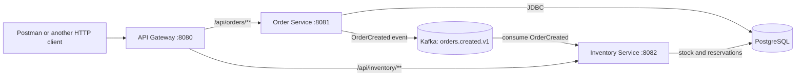
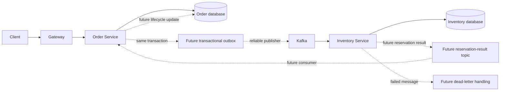

# ShopSphere project guide: purpose, concepts, and production roadmap

## Audience and purpose

This document is for learners, presenters, and developers who want to understand the whole ShopSphere backend: why it exists, what each application does, which software engineering concepts it teaches, what is working today, and what additional work a real production service would require.

ShopSphere is an **educational backend engineering curriculum and runnable starter**, not a finished online store. Its sample domain is online shopping: customers submit orders for products, inventory tracks stock, and services communicate through APIs and events. The project is intended to let a learner run a small working system, inspect requests in Postman and logs, read the code, and then implement production patterns as guided exercises.

Start the running applications using [the beginner run and Postman guide](13-beginner-run-and-postman-guide.md). This document focuses on meaning, architecture, learning goals, and the production gap.

## What problem the project models

A commerce backend must accept requests from a client, validate the requested action, keep durable records, track product availability, and tell other parts of a system when important things happen. A single request can cross several processes and storage systems, each of which can fail independently.

The starter makes those ideas visible with three Spring Boot applications and two infrastructure components:

- The **API Gateway** receives client HTTP requests and routes them to the owning API service.
- **Order Service** validates and records orders, then publishes an order-created event.
- **Inventory Service** looks up and reserves sample stock.
- **PostgreSQL** stores order records, stock counts, and reservation outcomes in the local setup.
- **Kafka** carries order-created events.

The project teaches the trade-offs behind these pieces: service ownership, synchronous HTTP versus asynchronous events, durable data, validation, correlation IDs, consistency, security, testing, and operations. It also includes learning plans for capabilities such as authentication, payments, notifications, WebSockets, webhooks, and sagas; those plans must not be confused with running applications that exist in this starter.

## Current implementation and future architecture

The first diagram shows the implemented applications and communications. Solid arrows identify the behavior currently in code. Local Compose infrastructure is shared for convenience; logical ownership is still split between Order Service and Inventory Service.



The current order-to-inventory sequence, including where the HTTP response returns before inventory work, is:

```mermaid
sequenceDiagram
  actor Client as Postman / client
  participant Gateway as Gateway :8080
  participant Orders as Order Service :8081
  participant DB as PostgreSQL
  participant Kafka as Kafka orders.created.v1
  participant Inventory as Inventory Service :8082
  Client->>Gateway: POST /api/orders
  Gateway->>Orders: Route by /api/orders/**
  Orders->>DB: INSERT order status=PENDING
  Orders->>Kafka: start async JSON send keyed by orderId; do not await ack
  Orders-->>Gateway: 201 Created, status=PENDING
  Gateway-->>Client: HTTP 201 Created
  Kafka-->>Inventory: deliver OrderCreated
  Inventory->>DB: INSERT unique reservation
  Inventory->>DB: decrement only if SKU exists and stock is enough
  Client->>Gateway: GET /api/inventory/reservations/{orderId}
  Gateway->>Inventory: Route by /api/inventory/**
  Inventory-->>Client: RESERVED or REJECTED
```

**Implemented now:** API Gateway, Order Service, Inventory Service, PostgreSQL order and inventory storage, Kafka publication and consumption for order reservations, health endpoints, request logging, and the local Postman collection.

**Shown as architecture topics or exercises:** reservation-result events and order-status updates, payments, notifications, realtime delivery, external webhooks, a production identity provider, a saga, and the transactional outbox. The `docs/01-architecture.md` diagram is a teaching target, not proof that all those components are present in code.

The planned reliability improvements fit around the current flow as follows. Dashed nodes and arrows are future work; they are not running components.



This target adds atomic order-and-event intent, explicit inventory result handling, retries, and a dead-letter path. It does not prescribe a single production implementation; requirements and failure guarantees must be decided first.

## Why each application and dependency exists

| Component | Why it is part of the project | What the current code does | Current limit |
|---|---|---|---|
| API Gateway (`gateway/`, port 8080) | Gives a client one entry point and keeps route selection outside business controllers. It is also a place to demonstrate edge authentication and request-level concerns. | Routes `/api/orders/**` to Order Service and `/api/inventory/**` to Inventory Service. It propagates `X-Correlation-ID`, logs request status/time, and can validate JWTs when a trusted issuer is configured. | Local configuration allows unauthenticated calls when `JWT_ISSUER_URI` is empty. No rate limiting, production gateway deployment, or full authorization policy is provided. |
| Order Service (`services/order-service/`, port 8081) | Owns order creation and retrieval so order rules/data have a clear boundary. | Validates a create request, writes an order row with JDBC to PostgreSQL, publishes an `OrderCreated` event to Kafka, and retrieves an order by ID. | Only create and get-by-ID APIs are implemented. The database write and Kafka publish are separate operations. Idempotency storage exists, but retry replay behavior does not. |
| Inventory Service (`services/inventory-service/`, port 8082) | Owns stock lookup and reservation behavior independently from the order API. | Reads and updates seeded stock in PostgreSQL. Consumes `OrderCreated`, atomically reserves stock, and records a unique reservation per order ID. | Local services share one PostgreSQL instance. Order remains PENDING because reservation results are not published back. |
| PostgreSQL | Demonstrates relational persistence, queries, constraints, and records that survive an application restart. | Stores orders, stock, and inventory reservations in service-owned tables initialized from each service's `schema.sql`. | Local services share one database instance. There is no versioned migration workflow, backup procedure, or high-availability configuration. |
| Kafka | Demonstrates asynchronous event publication and the difference between an HTTP response and a message consumed later. | Order Service publishes JSON messages to `orders.created.v1`; Inventory Service consumes them and reserves stock. Learners can inspect messages with a console consumer. | Single-node broker; no transactional outbox or dead-letter topic. |
| Postman | Provides a visible client for trying API methods and inspecting request/response data without a frontend. | The checked-in collection runs health, inventory, and order examples with assertions. | It is a development/demo tool, not an end-user application or load-testing platform. |

The services run as separate local Maven processes. `compose.yaml` currently runs PostgreSQL and Kafka; it does not containerize the Spring Boot services.

## Request and data flows

### Inventory lookup

1. Postman sends `GET /api/inventory/BK-001` to Gateway on port 8080.
2. Gateway matches `/api/inventory/**` and forwards the request to Inventory Service on port 8082.
3. Inventory Service reads stock from PostgreSQL and returns JSON such as `{"sku":"BK-001","available":25}`.
4. The same correlation ID appears in Gateway and Inventory Service logs.

### Inventory reservation

Postman sends `POST /api/inventory/BK-001/reserve?quantity=1` to Inventory Service. A successful call atomically decrements stock in PostgreSQL. A later GET shows the lower count. Order-driven reservations use Kafka instead of synchronous service-to-service HTTP.

### Order creation

1. Postman sends `POST /api/orders` to Gateway with JSON containing `customerId`, `sku`, and a positive `quantity`.
2. Gateway routes it to Order Service on port 8081 and propagates the correlation ID.
3. Order Service validates the request, inserts an order row into PostgreSQL, and sends an `OrderCreated` event to Kafka.
4. It responds with HTTP `201 Created`, including the generated order ID and status `PENDING`.
5. Inventory Service consumes the event, conditionally decrements stock, and writes a `RESERVED` or `REJECTED` reservation. A unique order ID makes repeated delivery idempotent.
6. Call `GET /api/inventory/reservations/{orderId}` through Gateway to inspect the result. Order remains `PENDING`; reservation-result events and status updates are not implemented.

### Consistency caveat in order creation

The database insert and Kafka send are two separate operations. If one succeeds and the other fails, PostgreSQL and Kafka can disagree. The project intentionally makes this dual-write risk a teaching point; the transactional outbox described in `docs/05-resilience-consistency-outbox-saga.md` is not implemented yet.

Order Service uses `KafkaTemplate.send` asynchronously and does not wait for its future to complete. Therefore an order response can arrive before a broker acknowledgement, and a `201` response alone does not prove that the event is durably present in Kafka. The classroom walkthrough separately checks the Kafka console and Inventory Service consumer log.

## Concepts the curriculum teaches

| Concept | Beginner explanation | Where to see it in this project |
|---|---|---|
| Spring Boot application | A Java process that starts a web server and registers application components. | The three `*Application.java` entry points and each module's `pom.xml`. |
| REST API and HTTP methods | A client uses URLs and methods to read or change a resource. | `GET` health/stock/order requests and `POST` reservation/order requests in Postman. |
| API Gateway | One public entry point forwards requests to the service responsible for the URL. | Gateway port 8080 and `gateway/src/main/resources/application.yml`. |
| Microservice boundary | A service owns focused business behavior and can run separately. | Order Service and Inventory Service are separate applications and ports. |
| Validation and status codes | Invalid input should be rejected clearly before changing data. | Quantity zero returns `400`; unknown SKU/order returns `404`; creation returns `201`. |
| Relational persistence | Structured data is stored durably and can be queried later. | Order Service JDBC calls, PostgreSQL, and `schema.sql`. |
| In-memory versus durable state | Process memory is simple but is lost when that process restarts. | Order rows, stock, and reservation records persist in PostgreSQL. |
| Event-driven communication | A service can publish a fact for another component to process asynchronously. | `OrderCreated` on Kafka topic `orders.created.v1`. |
| Correlation ID and logs | A label lets an operator match log records from one request across processes. | `X-Correlation-ID` response header and `logs/*.log`. |
| Idempotency | Repeating a request safely should not create duplicate business actions. | A database idempotency-key index exists, while API replay semantics are left as an exercise. |
| Transactional outbox | Store an outgoing event in the same database transaction as business data, then publish it reliably. | A production exercise; not yet implemented. |
| Saga and compensation | Coordinate a multi-service business operation through steps and compensating actions. | Basic order-to-inventory messaging runs today; persistent saga state and compensating actions for a larger checkout are future work. |
| Authentication and authorization | Authentication identifies a caller; authorization decides what that caller may access. | Gateway can validate JWT issuer configuration. Customer-level access checks are not implemented. |
| Observability | Logs, metrics, traces, and alerts help explain system behavior and detect failures. | Basic health/info/metrics and correlation-ID logs exist; production observability is incomplete. |

## A suggested learning path

Follow the materials in small steps. First run and observe the starter; then implement one production pattern at a time.

1. **Get oriented:** read this guide, `README.md`, and `docs/00-curriculum-map.md`.
2. **Run the system:** follow `docs/13-beginner-run-and-postman-guide.md`; verify all three health endpoints.
3. **Trace requests:** use Postman and the request log files. Match `X-Correlation-ID` between Gateway and the destination service.
4. **Understand boundaries:** inspect `docs/01-architecture.md`, `docs/02-microservices-gateway-discovery.md`, Gateway routes, and the two service controllers.
5. **Follow the data:** create an order, retrieve it, observe the Kafka event, wait for the Inventory Service consumer, inspect the reservation, and query PostgreSQL. Order rows, stock, and reservation records are durable in the local database.
6. **Study event design:** read `docs/04-kafka-events.md`; extend the existing consumer with versioned event schemas, bounded retry, dead-letter handling, and operational signals.
7. **Improve correctness:** add idempotency replay, a transactional outbox, reservation-result/order-status handling, and eventually a persisted saga. Basic atomic inventory reservation and order-ID deduplication already exist. Use `docs/05-resilience-consistency-outbox-saga.md` and `docs/10-implementation-spec.md` for criteria.
8. **Add security:** read `docs/03-auth-jwt-oauth2-oidc.md`; configure a trusted identity provider and enforce object-level authorization in each service.
9. **Practice operations:** use `docs/07-test-observe-deploy.md` and `docs/08-failure-labs.md` to add tests, metrics, failure handling, and deployment exercises.
10. **Extend only when justified:** consider whether a capability belongs in an existing service or a new independently owned service. More services bring network, deployment, testing, and data-consistency costs.

## Production readiness: what it would take

The current project is a local educational baseline. **It is not production-ready and should not be exposed as-is to the public internet.** A production system requires product requirements, threat modeling, load targets, deployment environment decisions, and operational ownership. The roadmap below identifies engineering work; it is not a claim that those protections are already included.

### 1. Define the production requirements

Before selecting infrastructure or splitting more services, define:

- Which clients and business actions are supported (create, view, cancel, refund, reserve, release).
- Expected request volume, peak traffic, latency targets, availability target, regions, and recovery objectives.
- Data retention, privacy obligations, audit needs, and deletion/export requirements.
- Payment provider, identity provider, deployment platform, and operational support model.
- Service ownership and which data each service is authoritative for.

Without these decisions, production sizing and architecture choices would be guesses.

### 2. Security and identity

- Deploy a trusted OAuth 2.0/OIDC identity provider and configure issuer, audience, and key rotation.
- Enforce authorization inside each service, including object-level checks so one customer cannot read another customer's orders.
- Require TLS between clients, gateway, services, and managed infrastructure as appropriate.
- Replace development credentials and defaults with a managed secret store; rotate credentials and certificates.
- Add gateway/service rate limits, request-size limits, secure CORS policy, and abuse controls.
- Redact personal, payment, and credential data from logs; define retention and access controls.
- Treat payment card data according to the selected provider's integration model and applicable compliance requirements; avoid storing raw card data.

### 3. Durable data and business correctness

- Replace `schema.sql` startup initialization with versioned database migrations and tested roll-forward/rollback procedures.
- Add reservation expiry/release rules, return stock safely on cancellation, and test atomic inventory updates under concurrency. The starter already stores inventory in PostgreSQL and uses conditional stock updates.
- Add complete order lifecycle operations, state transition rules, customer ownership checks, and audit history.
- Implement idempotency-key replay semantics so client retries return the original outcome rather than creating another order or failing unpredictably.
- Implement the transactional outbox so order state and event intent commit atomically; publish with retries and monitor outbox age.
- Extend the existing order-ID reservation deduplication with an explicit processed-event/inbox model if event identities and multiple event types are introduced.
- Define payment authorization/capture/refund and failure handling only after selecting a provider; do not treat a Kafka event alone as proof of payment.
- If checkout spans orders, inventory, and payment, persist saga state, define timeout behavior, and implement compensating actions.

### 4. Reliable messaging and service communication

- Define versioned event schemas and compatibility rules. Document keys, partitions, retention, replay, and ownership of each topic.
- Configure production Kafka replication, access control, encryption, quotas, retention, backups/recovery, and disaster recovery.
- Set bounded timeouts, retry/backoff policies, circuit breakers where justified, and dead-letter handling. Avoid unbounded retries and duplicate side effects.
- Decide which calls require an immediate answer over HTTP and which can be asynchronous events. Do not make all service communication asynchronous by default.
- Add service discovery/load balancing only when the deployment environment needs it. Local container DNS is sufficient for the Compose learning setup.

### 5. Tests and release safety

- Add unit tests for business rules and idempotency, API tests for validation/status behavior, and integration tests against disposable PostgreSQL and Kafka.
- Add contract tests for HTTP interfaces and Kafka event compatibility.
- Test duplicate deliveries, database and broker outages, timeouts, partial failures, concurrent inventory reservations, and restart/recovery behavior.
- Add performance/load tests with explicit latency and throughput thresholds.
- Add CI checks for formatting, compile, tests, dependency/security scanning, container/image scanning, and artifact provenance.
- Deploy through a repeatable pipeline with environment-specific configuration, health gates, staged rollout, rollback, and database migration compatibility.

### 6. Operations and observability

- Use structured logs and a centralized log platform; use distributed tracing (for example OpenTelemetry) across gateway, HTTP calls, database, and Kafka. The current correlation header is helpful but is not distributed tracing.
- Publish and dashboard request rate, error rate, latency percentiles, JVM health, database pool use, Kafka consumer lag, retry counts, dead-letter volume, and outbox age.
- Define alert thresholds around user impact and assign responders/runbooks.
- Configure readiness and liveness separately. Liveness should not restart a service merely because a remote dependency is temporarily down.
- Add graceful shutdown, resource limits, autoscaling criteria, service-level objectives, and incident procedures.
- Back up PostgreSQL, test restores, and define Kafka retention/recovery expectations. A backup is only useful if restore is practiced.
- Set capacity limits and retention for logs, metrics, traces, and event data.

### 7. Deployment and environment design

- Replace the single-node local Docker Compose infrastructure with managed or highly available production infrastructure suitable for requirements.
- Build and publish immutable container images for each Spring Boot application, pin dependencies/images, and patch them on a defined cadence.
- Separate local, test, staging, and production configuration and secrets. Do not package environment credentials into images or source control.
- Configure network policies, private service access, ingress/TLS, DNS, database connection limits, and Kafka ACLs.
- Choose Kubernetes or another orchestrator only if its operational benefits justify the added complexity; it is not required simply because the application uses microservices.

## Production gap summary

| Area | Starter today | Needed before real production use |
|---|---|---|
| Applications | Three local Spring Boot processes | Reproducible deployment, resource limits, rollout/rollback, runtime ownership |
| Authentication | Optional JWT validation at Gateway | Trusted identity configuration plus authorization checks in services |
| Orders | Create and get-by-ID | Full lifecycle, durable migration, idempotent retries, access control, audit |
| Inventory | Durable stock and atomic idempotent reservation | Reservation release/expiry, concurrency and recovery tests |
| Events | OrderCreated publish and Inventory Service consumer; reservation deduplication uses order ID | Transactional outbox, versioned schema governance, bounded retries/DLT, consumer-lag monitoring, broker HA |
| Consistency | Order-to-inventory event flow works, but the order/event dual write remains and order stays PENDING | Outbox, reservation-result handling, order state transitions, and (if required) persisted saga and compensations |
| Observability | Health endpoints and correlation-ID logs | Central logs, traces, metrics, dashboards, alerts, retention, runbooks |
| Testing | Starter module tests and curriculum plan | Integration, contract, security, failure, load, restore, and release-gate coverage |
| Infrastructure | Single-node local Compose database and broker | Managed/HA services, secrets, network controls, backup/restore, recovery plan |

Use `docs/10-implementation-spec.md` as the concrete course acceptance checklist. Production readiness is a system property that must be verified against requirements; completing a checklist alone does not certify security, availability, or regulatory compliance.

## Project layout and where to look

```text
shopsphere-backend/
├── gateway/                    # Spring Cloud Gateway application and routes
├── services/
│   ├── order-service/          # Order API, JDBC persistence, Kafka publisher
│   └── inventory-service/      # Inventory API, PostgreSQL stock, Kafka consumer
├── postman/                    # Local collection, environment, HTTP examples, and usage guide
├── scripts/                    # Compose infrastructure start/stop helpers
├── docs/                       # Curriculum, architecture, setup, labs, and guides
├── compose.yaml                # Local PostgreSQL and Kafka only
├── Makefile                    # Common infrastructure and development shortcuts
└── README.md                   # Entry point and links to the guides
```

Each Java application has a `pom.xml`, `src/main/java` for application code, `src/main/resources` for configuration/schema, and `src/test/java` for tests. Maven-generated `target/` folders are build output and should not be edited. The detailed tree and file-by-file explanation is in [Running and extending ShopSphere](11-running-and-extending.md#9-project-structure).

## Related project documents

- [Beginner run and Postman guide](13-beginner-run-and-postman-guide.md)
- [Postman walkthrough and request tracing](12-postman-and-request-tracing.md)
- [Curriculum map](00-curriculum-map.md)
- [Architecture and domain boundaries](01-architecture.md)
- [Implementation specification and acceptance criteria](10-implementation-spec.md)
- [Testing, observability, and deployment](07-test-observe-deploy.md)
- [Resilience, idempotency, outbox, and saga](05-resilience-consistency-outbox-saga.md)
