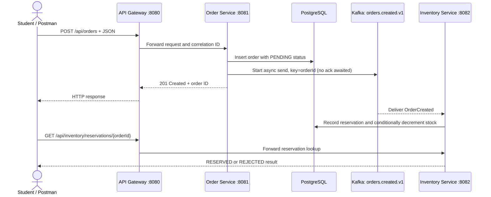

# ShopSphere classroom demo: presenter runbook

This is a detailed, follow-along lesson for demonstrating how one order moves through ShopSphere. It is written for a presenter who may be new to Spring Boot, Postman, Kafka, or microservices. Follow the numbered checkpoints in order; each one says what to click or run, what result to expect, where to see the work, and what to explain to students.

Use this with the [beginner setup and Postman guide](13-beginner-run-and-postman-guide.md). For the project's scope and remaining production work, see the [project concepts and production roadmap](14-project-purpose-concepts-and-production-roadmap.md).

## Contents

1. [What you are demonstrating](#1-what-you-are-demonstrating)
2. [Quick reference](#2-quick-reference-for-the-presenter)
3. [Start the project and viewers](#3-start-from-a-known-healthy-setup)
4. [Prepare Postman](#4-prepare-postman-carefully)
5. [Health checks](#5-demo-0--prove-each-application-is-reachable)
6. [Gateway stock lookup](#6-demo-1--route-a-stock-lookup-through-gateway)
7. [Direct reservation and validation examples](#7-demo-2--compare-gateway-routing-and-a-direct-service-request)
8. [Create and retrieve an order](#8-demo-3--create-and-retrieve-an-order)
9. [Kafka consumption and reservation](#9-demo-4--watch-inventory-service-reserve-stock-asynchronously)
10. [Downstream rejection](#10-demo-5--show-the-downstream-rejection-case)
11. [Validation errors](#11-demo-6--show-validation-errors)
12. [Inspect PostgreSQL](#12-confirm-the-database-changes-directly)
13. [Collection Runner](#13-postman-collection-runner-instructions)
   - [Optional demo A: trace HTTP requests through Gateway and services](#optional-demo-a-trace-http-requests-through-gateway-and-services)
   - [Optional demo B: compare direct service access with Gateway routing](#optional-demo-b-compare-direct-service-access-with-gateway-routing)
   - [Optional demo C: demonstrate a rejected reservation and unchanged stock](#optional-demo-c-demonstrate-a-rejected-reservation-and-unchanged-stock)
   - [Optional demo D: inspect Kafka independently](#optional-demo-d-inspect-kafka-independently)
14. [Code tour](#14-code-tour-which-files-to-open-and-when)
15. [What each screen proves](#15-what-each-screen-and-signal-proves)
16. [Troubleshooting](#16-troubleshooting-by-symptom)
17. [Data and reset notes](#17-data-persistence-and-reset-notes)
18. [Wrap-up explanation](#18-close-with-an-accurate-explanation-of-the-project)

## 1. What you are demonstrating

ShopSphere is a backend teaching project. It has no storefront or graphical shopping site. Postman acts as the client, and you will use the service terminals, log files, PostgreSQL, and Kafka console to see what the backend does.

The central lesson is that an order request and inventory reservation are two separate steps. Order Service saves an order, starts an asynchronous Kafka send without waiting for broker acknowledgement, and returns. Inventory Service receives a delivered event asynchronously and reserves stock. The HTTP response can arrive before Kafka acknowledges the send or before reservation finishes.



The arrows show the intended teaching flow. The order remains `PENDING` after Inventory Service finishes because this implementation does not publish a reservation-result event back to Order Service.

## 2. Quick reference for the presenter

| Application or tool | Local address / location | What it does in this lesson |
|---|---|---|
| Postman | Desktop application | Sends HTTP requests and shows status, response JSON, headers, and test results. |
| API Gateway | `http://localhost:8080` | Public HTTP entry point; routes order and inventory API paths. |
| Order Service | `http://localhost:8081` | Validates orders, writes order rows, starts the asynchronous `OrderCreated` send, and retrieves orders. |
| Inventory Service | `http://localhost:8082` | Reads stock, accepts direct reservations, consumes `OrderCreated`, and exposes reservation results. |
| PostgreSQL | `localhost:5432` | Stores orders, stock, and reservation rows in the local learning setup. |
| Kafka | `localhost:9092` from your computer | Carries `OrderCreated` messages from Order Service to Inventory Service. |
| Kafka console in Compose | `kafka:19092` from inside Docker | Lets the console consumer print messages from the topic. |
| Service log files | `logs/*.log` | Show request tracing and the Inventory Service consumer outcome. |

The local Compose setup uses one PostgreSQL instance shared by the services and a single Kafka broker. That keeps the class setup approachable; it does not represent production isolation or high availability.

## 3. Start from a known, healthy setup

### 3.1 Open the correct folder

Open the repository folder in VS Code or another editor. The project root is the folder containing `README.md`, `compose.yaml`, `gateway/`, `services/`, `docs/`, and `postman/`. Run all commands in this guide from that root unless the command says otherwise.

Open a terminal using **Terminal → New Terminal** in VS Code. Check the required tools:

```sh
java -version
mvn -version
docker compose version
```

Java should report version 21 or newer. Maven should report 3.9 or newer. Docker Compose should report version 2 or newer. If a command is not found, use the installation steps in [Running and extending ShopSphere](11-running-and-extending.md).

### 3.2 Start PostgreSQL and Kafka

Make sure Docker Desktop is running. In the terminal at the repository root, run:

```sh
docker compose up -d postgres kafka
docker compose ps
```

Wait until both `postgres` and `kafka` show `healthy`. On the first run, Docker may need to download images, so this can take a few minutes. If they remain unhealthy, pause the demo and use the Docker troubleshooting section below.

### 3.3 Start the three Spring Boot applications

Open three more terminals. Run one command in each from the repository root, and leave each terminal open.

**Terminal 1 — Inventory Service:**

```sh
mvn -f services/inventory-service/pom.xml spring-boot:run
```

**Terminal 2 — Order Service:**

```sh
mvn -f services/order-service/pom.xml spring-boot:run
```

**Terminal 3 — API Gateway:**

```sh
mvn -f gateway/pom.xml spring-boot:run
```

Wait for a `Started ...` message in each terminal. Inventory Service connects to PostgreSQL and Kafka. Order Service connects to PostgreSQL and Kafka. Gateway connects to the two application services over HTTP. Pressing `Ctrl+C` in any one service terminal stops that service.

### 3.4 Start the live log view

Open another terminal and run:

```sh
tail -f logs/gateway.log logs/order-service.log logs/inventory-service.log
```

This terminal displays new lines as they are written. You can also open each log file in VS Code's Explorer, but that view may not refresh as clearly as `tail -f`. Keep the three application terminals open too: they contain startup errors and the same application logs.

### 3.5 Start a Kafka message viewer

Open one more terminal and run this before creating the order:

```sh
docker compose exec kafka /opt/kafka/bin/kafka-console-consumer.sh --bootstrap-server kafka:19092 --topic orders.created.v1
```

Leave this terminal open. It may show no output while it waits; that is normal. A new order event should print as JSON when Kafka receives the Order Service send. Stop only the viewer with `Ctrl+C` when the lesson is finished.

The command connects to `kafka:19092` because it runs inside the Docker network. Spring services running directly on your computer connect to `localhost:9092`.

## 4. Prepare Postman carefully

### 4.1 Import the collection and environment

In Postman Desktop:

1. Click **Import**. Some layouts put it under **Use resources → Import**.
2. Select **Files** and choose `postman/shopsphere-local.postman_collection.json` from the repository.
3. Import `postman/shopsphere-local.postman_environment.json` from the same `postman/` folder.
4. Use the environment selector near the upper right to select **ShopSphere Local**.
5. Expand **Collections → ShopSphere Local API** in the left sidebar.
6. Confirm the collection has **1 - Health checks**, **2 - Inventory flow**, and **3 - Order flow**.

The order folder should contain requests **3.1** through **3.7**. If those requests are missing, Postman is showing an older imported copy. Import the current collection JSON again. If Postman creates another copy, use the newly imported collection for the lesson; Postman does not sync a file on disk automatically.

### 4.2 Understand the selected environment

The environment fills values into request URLs and bodies. Open the **ShopSphere Local** environment to see the variables.

| Variable | Sample value | Used for |
|---|---|---|
| `baseUrl` | `http://localhost:8080` | Gateway URL used for the business requests in this lesson. |
| `orderServiceUrl` | `http://localhost:8081` | Direct Order Service URL used for its health check. |
| `inventoryServiceUrl` | `http://localhost:8082` | Direct Inventory Service URL and direct reservation comparison. |
| `sku` | `BK-001` | A seeded sample inventory item. |
| `unknownSku` | `NO-SUCH-SKU` | Deliberately unknown item for the rejection demo. |
| `quantity` | `1` | Number of units in the ordinary order example. |
| `customerId` | `customer-123` | Sample customer identifier. |
| `correlationId` | Set automatically | Links request logs across Gateway and a service. |
| `orderId` | Set by request 3.1 | Order ID returned by Order Service. |
| `rejectedOrderId` | Set by request 3.6 | Order ID for the unknown-SKU rejection example. |

The collection creates a new correlation ID for each request. Request **3.1** also creates a new idempotency key. An order ID identifies a business order; a correlation ID identifies one HTTP request and its log trail. They are different values.

### 4.3 Know where a Postman result appears

Click a request name in the collection to open it. The method (`GET` or `POST`) appears to the left of its URL. Click **Send** to run it. In the response panel below, use:

- **Body** to read the returned JSON;
- the status display (for example, `200 OK` or `201 Created`) to see the HTTP result;
- **Headers** to find `X-Correlation-ID`;
- **Test Results** to see assertions that the collection ran against the response.

The request editor's **Body** tab shows JSON for `POST` requests. For the direct reservation request, quantity is a query parameter in the URL rather than JSON.

## 5. Demo 0 — prove each application is reachable

Open **1 - Health checks** and send the following requests one at a time:

| Postman request | Method and address | Expected status and body | What it confirms |
|---|---|---|---|
| **1.1 Gateway health** | `GET http://localhost:8080/actuator/health` | `200 OK`, `{"status":"UP"}` | Gateway is running. |
| **1.2 Order Service health** | `GET http://localhost:8081/actuator/health` | `200 OK`, `{"status":"UP"}` | Order Service is running and reachable directly. |
| **1.3 Inventory Service health** | `GET http://localhost:8082/actuator/health` | `200 OK`, `{"status":"UP"}` | Inventory Service is running and reachable directly. |

**Show students:** switch to each service terminal and point to its Spring Boot startup message. The health requests make direct calls to the service ports for checking availability. The business API examples below use Gateway.

**If a check fails:** confirm the service terminal is still open and did not exit with an error. Check that Docker reports PostgreSQL and Kafka as healthy. Check the URL and port. If a port is already in use, another process may already be running; do not start a second copy on that same port.

## 6. Demo 1 — route a stock lookup through Gateway

### Send the request

Open **2 - Inventory flow → 2.1 Get stock through Gateway**. Confirm that the request is `GET`, then click **Send**.

The URL resolves to:

```http
GET http://localhost:8080/api/inventory/BK-001
```

No body is needed for a `GET` request.

### Expected Postman result

Expect `200 OK` and JSON in this shape:

```json
{
  "sku": "BK-001",
  "available": 25
}
```

The exact available count may be lower if this PostgreSQL database was used before. Stock persists between Inventory Service restarts. `25` is the initial seed value only when the inventory row is first created in a fresh database.

### Find the request in logs

1. In Postman, select the response **Headers** tab and find `X-Correlation-ID` (header names may display with different capitalization).
2. Find that same value in `logs/gateway.log` and `logs/inventory-service.log`, or in the combined `tail -f` terminal.
3. The Gateway log shows the request entering and completing at the edge. The Inventory Service log shows the downstream service handling it.

Each HTTP request gets its own correlation ID. When making the next Postman request, expect a different ID.

### Explain the route

Gateway matches `/api/inventory/**` and forwards this request to Inventory Service on port 8082. Inventory Service owns the stock lookup and database access. Gateway chooses where the request goes; it does not decide the stock count.

Show the route in `gateway/src/main/resources/application.yml`, then show `getStock` in `services/inventory-service/src/main/java/com/shopsphere/inventory/InventoryController.java`.

## 7. Demo 2 — compare Gateway routing and a direct service request

This section contains an intentionally direct Inventory Service call for teaching and diagnosis. It is not the customer order flow. The normal order demonstration starts at the Gateway in section 8 and lets Inventory Service reserve stock after it consumes the Kafka event.

### 7.1 Change stock directly

**Presenter note:** this operation immediately changes the persisted stock count. It is useful for showing an Inventory endpoint in isolation, but it does not create an order, publish a Kafka event, or demonstrate order-driven reservation. Skip it during the main end-to-end run if you want stock changes to come only from orders. If you do run it, note the stock count before and after so students can see its effect on later examples.

In **2 - Inventory flow**, open **2.3 Reserve stock directly** and click **Send**. This request uses:

```http
POST http://localhost:8082/api/inventory/BK-001/reserve?quantity=1
```

It calls Inventory Service on port 8082 directly. It does not go through Gateway. There is no JSON body; `quantity=1` is in the query string.

Expect `200 OK` and a body like:

```json
{
  "sku": "BK-001",
  "available": 24
}
```

The returned count depends on its value before the request. It should decrease by one if one or more units were available. This sample project exposes the direct endpoint without authentication for local learning. A production application should restrict stock adjustments to trusted internal workflows or authorized staff operations, and record who made each adjustment.

Now send **2.1 Get stock through Gateway** again. It should report the same new count. This confirms the direct request changed persisted stock and Gateway reads that same stock through Inventory Service.

**Where the work appears:** this direct call appears in `logs/inventory-service.log`; it should not appear as a business request in `logs/gateway.log`. The later GET through Gateway appears in both Gateway and Inventory Service logs.

**Explain:** both routes reach the same Inventory Service. The direct address is useful for service-level debugging. A client-facing application normally calls the Gateway address so it uses the common entry point.

### 7.2 Show an unknown stock item

Send **2.2 Unknown SKU returns 404**. It sends a `GET` for `NO-SUCH-SKU` through Gateway. Expect `404 Not Found`. This means the request reached the service, but the stock table has no matching SKU. Postman's test for this request should pass because 404 is the expected result for this demonstration.

### 7.3 Show invalid reservation input

Send **2.4 Invalid reservation quantity returns 400**. It sends a `POST` with `quantity=0` directly to Inventory Service. Expect `400 Bad Request`; quantity must be a positive number. This request should not reduce stock.

Inventory Service also returns `409 Conflict` if a direct reservation asks for more stock than is available. This is a business conflict, different from malformed input (`400`) or an unknown SKU (`404`).

## 8. Demo 3 — create and retrieve an order

### 8.1 Start observing Kafka first

Make sure the Kafka console command in section 3.5 is still running before you create an order. This avoids missing the new event. If the terminal is not open, run:

```sh
docker compose exec kafka /opt/kafka/bin/kafka-console-consumer.sh --bootstrap-server kafka:19092 --topic orders.created.v1
```

### 8.2 Inspect and send the Postman request

Open **3 - Order flow → 3.1 Create order through Gateway**. Select the **Body** tab so students can see the submitted JSON:

```json
{
  "customerId": "customer-123",
  "sku": "BK-001",
  "quantity": 1
}
```

Postman substitutes `{{customerId}}`, `{{sku}}`, and `{{quantity}}` from the selected environment. Confirm the method is `POST`, and click **Send**. The resolved URL should be `http://localhost:8080/api/orders`.

### 8.3 Read the HTTP response

Expect `201 Created`. The response is similar to:

```json
{
  "id": "<generated-order-id>",
  "customerId": "customer-123",
  "sku": "BK-001",
  "quantity": 1,
  "status": "PENDING",
  "createdAt": "<timestamp>"
}
```

The exact ID and timestamp change every time. The collection's test script saves the response `id` into `orderId` in the selected environment. You can open that environment and see the value, or inspect the resolved URL in request **3.2**.

`201 Created` proves Order Service accepted the request and created an order record. It does not by itself prove Kafka acknowledged the event or Inventory Service finished. The response status `PENDING` means inventory work has not been reflected in the order status. Confirm delivery in the Kafka viewer and consumer log; do not describe `201` as proof that stock was successfully reserved.

### 8.4 See the HTTP route and correlation ID

Open the response's **Headers** tab and copy `X-Correlation-ID`. Find it in:

- `logs/gateway.log` for Gateway's request start and completion;
- `logs/order-service.log` for Order Service's request start and completion.

The same ID appears in both because Gateway forwards it downstream. The current Kafka event does not include the correlation ID, so find the asynchronous consumer log using the order ID instead. Kafka processing is not part of the HTTP request's log chain.

Show `create` in `services/order-service/src/main/java/com/shopsphere/orders/OrderController.java`. Point out the order insert, the `kafka.send` call to `orders.created.v1`, and the response with `PENDING`. The database write and Kafka publish are separate operations in this teaching implementation.

### 8.5 Find the event in Kafka

Look at the Kafka console terminal. A new JSON message should appear, similar to:

```json
{"orderId":"<same-generated-order-id>","customerId":"customer-123","sku":"BK-001","quantity":1,"createdAt":"<timestamp>"}
```

The `orderId` should match the Postman response. Order Service uses that ID as the Kafka message key. The event contains the facts Inventory Service needs: order ID, customer ID, SKU, quantity, and creation time.

If no event appears, check that the Kafka viewer was started before the order, Kafka is healthy, and Order Service is still running. Inspect the Order Service terminal for Kafka errors.

### 8.6 Read the order back through Gateway

Send **3.2 Get created order through Gateway**. It sends:

```http
GET http://localhost:8080/api/orders/{{orderId}}
```

Postman substitutes the ID saved by request 3.1. Expect `200 OK` and the same order details. This request demonstrates that Order Service reads the order row from PostgreSQL. If the URL contains a blank ID, send request 3.1 first and confirm the **ShopSphere Local** environment is selected.

## 9. Demo 4 — watch Inventory Service reserve stock asynchronously

### 9.1 Watch for the consumer log

After the Kafka message appears, look at `logs/inventory-service.log` or the live combined log terminal. Find a line similar to:

```text
component=inventory event=OrderCreated orderId=<same-generated-order-id> sku=BK-001 quantity=1 reservationStatus=RESERVED reason=null
```

This is evidence that the Inventory Service Kafka listener consumed and interpreted the event, then stored a reservation result. The Kafka viewer only proves the event was published; this Inventory Service log proves this application processed it.

### 9.2 Check the reservation in Postman

Send **3.3 Check reservation through Gateway**. It calls:

```http
GET http://localhost:8080/api/inventory/reservations/{{orderId}}
```

Expect `200 OK` and JSON similar to:

```json
{
  "orderId": "<same-generated-order-id>",
  "sku": "BK-001",
  "quantity": 1,
  "status": "RESERVED",
  "reason": null
}
```

This request enters Gateway and is routed to Inventory Service. The service looks up the reservation row by order ID. The `orderId`, `sku`, and `quantity` should match the order and Kafka message.

If it returns `404 Not Found`, do not create another order immediately. The listener may still be processing the message. Wait for the matching `event=OrderCreated` line and send request 3.3 again. A 404 here means no reservation row is visible yet; it does not mean the original order was not created.

### 9.3 Check the new stock count

Send **3.4 Check remaining stock through Gateway**. It calls:

```http
GET http://localhost:8080/api/inventory/{{sku}}
```

Expect `200 OK`, the SKU, and a numeric `available` count. For a one-unit order with a fresh stock value of 25, the count should now be 24, except for any direct reservations or previous orders run during the class.

For the strongest check, record the stock count before request 3.1 and compare it with the value after request 3.3 reports `RESERVED`. The expected calculation is:

```text
stock after = stock before - order quantity
```

If the reservation status is `REJECTED`, stock should not decrease for that order.

### 9.4 Explain the order of events

The first request is synchronous from Postman's perspective: Postman waits for Order Service to return `201`. The Kafka consumer is an independent process. It may finish quickly, but it is not part of the HTTP response path. This separation is why the response says `PENDING` and why you wait for the Inventory Service log before looking up the reservation.

The Inventory Service uses a database transaction to create the reservation record and conditionally decrement stock. The reservation table has `order_id` as its primary key. If Kafka delivers the same order event again, the existing row prevents the handler from decrementing stock for that order a second time.

## 10. Demo 5 — show the downstream rejection case

This demonstrates the difference between accepting an order request and successfully reserving its stock.

### 10.1 Create an order with an unknown SKU

Send **3.6 Create order for unknown SKU (reservation rejection demo)**. Its body uses `NO-SUCH-SKU` and quantity `1`. The SKU is unknown to Inventory Service, but Order Service validates only that `customerId` and `sku` are not blank and that quantity is at least one.

Expect `201 Created` and status `PENDING`. The Postman test saves the generated order ID in the environment variable `rejectedOrderId`. A Kafka `OrderCreated` event should appear with the unknown SKU.

### 10.2 Wait for Inventory Service and inspect the result

Wait for an Inventory Service log line for this order ID with `reservationStatus=REJECTED` and `reason=UNKNOWN_SKU`. Then send **3.7 Check rejected reservation through Gateway**.

Expect `200 OK` and JSON similar to:

```json
{
  "orderId": "<rejected-order-id>",
  "sku": "NO-SUCH-SKU",
  "quantity": 1,
  "status": "REJECTED",
  "reason": "UNKNOWN_SKU"
}
```

The HTTP order request succeeded because Order Service saved the order and published the event. The later inventory step rejected it because that SKU is not in the inventory table. The order itself remains `PENDING`: this project does not yet publish an inventory result event or update the order status.

This shows an important distributed-system boundary: a successful response from one service does not guarantee that a later asynchronous business action succeeded.

## 11. Demo 6 — show validation errors

These requests intentionally return error statuses. They are useful to show that HTTP error responses are expected outcomes for invalid examples, not necessarily application crashes.

| Collection request | What it sends | Expected status | What students should learn |
|---|---|---:|---|
| **2.2 Unknown SKU returns 404** | Looks up a SKU that is not present. | `404 Not Found` | The resource does not exist. |
| **2.4 Invalid reservation quantity returns 400** | Attempts to reserve quantity zero. | `400 Bad Request` | Invalid input is rejected before stock changes. |
| **3.5 Invalid order quantity returns 400** | Creates an order with quantity zero. | `400 Bad Request` | Bean validation rejects the request before order insertion and Kafka publication. |

Postman shows the response status and the request's **Test Results**. The tests for these examples should pass when the expected error code is returned.

## 12. Confirm the database changes directly

Postman is enough to run the API, but these read-only SQL queries let students see the stored records in PostgreSQL. Open a terminal at the repository root.

Show the recent orders:

```sh
docker compose exec postgres psql -U shopsphere -d shopsphere -c "SELECT id, customer_id, sku, quantity, status, created_at FROM orders ORDER BY created_at DESC LIMIT 10;"
```

Show current inventory stock:

```sh
docker compose exec postgres psql -U shopsphere -d shopsphere -c "SELECT sku, available FROM inventory_stock ORDER BY sku;"
```

Show recent reservation outcomes:

```sh
docker compose exec postgres psql -U shopsphere -d shopsphere -c "SELECT order_id, sku, quantity, status, reason FROM inventory_reservations ORDER BY order_id DESC LIMIT 10;"
```

For the successful order, the same ID appears in the `orders.id`, the Kafka message `orderId`, and `inventory_reservations.order_id`. For the rejected order, the reservation row has `REJECTED` and `UNKNOWN_SKU`. These queries only read data; they do not change it.

## 13. Postman Collection Runner instructions

For a live class, sending one request at a time is easiest because you can pause to show each log and terminal. To run the collection automatically:

1. Select the **ShopSphere Local** environment.
2. Open the collection's **Run** option.
3. Choose the health, inventory, and order folders or the full collection.
4. Set the delay between requests to **1,000 ms**.
5. Start the run and review its request-by-request output and final test summary.

The delay gives the Kafka listener time to process an order before the reservation lookup. The consumer is asynchronous, so if request 3.3 still runs too soon and gets 404, use manual mode: wait for its matching Inventory Service log and resend 3.3. The usual success path expects enough remaining stock for the requested quantity. Repeated demos reduce the persistent count; the value is not reset when an application restarts.

## Optional demo A: trace HTTP requests through Gateway and services

This exercise shows what the request logging and correlation ID do. It also clarifies an important boundary: a correlation ID follows one HTTP request through Gateway to its destination service. Kafka processing happens later, so use the order ID to connect the asynchronous inventory work to the original request.

### A.1 Trace an inventory lookup from Postman to Inventory Service

1. Make sure the combined log viewer from section 3.4 is running, or open a terminal at the repository root.
2. In Postman, send **2.1 Get stock through Gateway**.
3. Open the response **Headers** tab and copy the value of `X-Correlation-ID`. This is the trace ID for this one HTTP request.
4. In a terminal at the repository root, search both log files. Replace the example value with the exact ID you copied:

   ```sh
   grep 'PASTE-CORRELATION-ID-HERE' logs/gateway.log logs/inventory-service.log
   ```

5. Find the two `component=gateway` lines and the two `component=inventory` lines. Each service normally writes a `started` and a `completed` line. The ID should match across all four lines because Gateway forwarded the request header to Inventory Service.

Example shape (timestamps, thread names, and the ID will differ):

```text
INFO ... component=gateway correlationId=<trace-id> method=GET path=/api/inventory/BK-001
INFO ... component=inventory correlationId=<trace-id> method=GET path=/api/inventory/BK-001
INFO ... component=inventory correlationId=<trace-id> method=GET path=/api/inventory/BK-001 status=200 ...
INFO ... component=gateway correlationId=<trace-id> method=GET path=/api/inventory/BK-001 status=200 ...
```

The precise order of completion lines can vary slightly because Gateway is reactive. The key evidence is that the same correlation ID appears at the Gateway and destination service.

### A.2 Trace order creation and its later inventory processing

1. Ensure the Kafka console consumer is open as described in section 3.5.
2. Send **3.1 Create order through Gateway**. Copy both `id` from the JSON response and `X-Correlation-ID` from the response headers.
3. Search the Gateway and Order Service logs using the correlation ID:

   ```sh
   grep 'PASTE-CORRELATION-ID-HERE' logs/gateway.log logs/order-service.log
   ```

   You should find the same ID in the Gateway and Order Service request logs for `POST /api/orders`.
4. Find the matching JSON event in the Kafka console using the order ID. The event payload does not currently contain the HTTP correlation ID.
5. Find the Inventory consumer line using the order ID:

   ```sh
   grep 'PASTE-ORDER-ID-HERE' logs/inventory-service.log
   ```

   Expect `event=OrderCreated` and an outcome such as `reservationStatus=RESERVED`.
6. Send **3.3 Check reservation through Gateway**. This is a new HTTP request, so it has a new correlation ID. That new ID appears in Gateway and Inventory HTTP logs; the order ID in its URL connects this request to the earlier order and Kafka work.

Explain that there is not one continuous HTTP call from Gateway through Order Service, Kafka, and Inventory Service. The order creation HTTP request finishes independently. Kafka then delivers an event, and the reservation lookup is another HTTP request. The `orderId` is the business identifier that joins those steps; the `X-Correlation-ID` is scoped to each individual HTTP request.

### A.3 Show where the live and saved logs are

- The service terminal shows startup messages and live application logs while Maven is running.
- The project `logs/` directory contains `gateway.log`, `order-service.log`, and `inventory-service.log` when file logging is enabled.
- Keep the Kafka console consumer in its own terminal. It displays Kafka message values, not Spring application logs.
- If `grep` reports that a log file does not exist, confirm the terminal's current directory is the repository root and that the service is configured to write to that project's `logs/` directory. You can locate a file from the root with `find . -name 'inventory-service.log'`.

## Optional demo B: compare direct service access with Gateway routing

This read-only comparison teaches Gateway routing without changing stock. It is the preferred comparison for a first class; the direct reservation in section 7.1 changes durable data.

1. In Postman, send **2.1 Get stock through Gateway**, which calls `GET http://localhost:8080/api/inventory/BK-001`.
2. In a terminal, call the same read endpoint directly:

   ```sh
   curl http://localhost:8082/api/inventory/BK-001
   ```

3. Compare the JSON responses. Both should report the same current stock because both requests reach the same Inventory Service and PostgreSQL database.
4. Compare the logs. The Gateway request should appear in `gateway.log` and `inventory-service.log`. The direct request should appear in `inventory-service.log` only; it bypassed Gateway.
5. Point to the Gateway route configuration in `gateway/src/main/resources/application.yml`. Explain that the client-facing URL is port 8080, while the service's direct address is useful for local diagnostics. A direct URL is not evidence that a request traversed Gateway.

For a second comparison, call the Gateway health endpoint on port 8080 and the direct service health endpoints on ports 8081 and 8082 (section 5). Health checks intentionally contact each application directly so a presenter can tell which process is unavailable.

## Optional demo C: demonstrate a rejected reservation and unchanged stock

The existing unknown-SKU workflow in section 10 already demonstrates rejection. This optional checkpoint makes the stock consequence explicit and gives you an additional failure case when there is not enough stock.

### C.1 Unknown SKU: reservation rejected

1. Before sending **3.6 Create order for unknown SKU**, send **2.1 Get stock through Gateway** and note the `BK-001` count. This is a read-only baseline.
2. Send **3.6**, then copy `rejectedOrderId` from the response or the selected Postman environment.
3. Wait for the Kafka message and Inventory Service line for that order ID. The line should contain `reservationStatus=REJECTED reason=UNKNOWN_SKU`.
4. Send **3.7 Check rejected reservation through Gateway**. Confirm the response has `status=REJECTED` and `reason=UNKNOWN_SKU`.
5. Send **2.1** again. The `BK-001` stock count should match the baseline because this order named a different, nonexistent SKU and did not consume `BK-001` stock.

The order still exists and its HTTP request returned `201 Created`; the rejection happened later in Inventory Service. Do not describe the rejected inventory outcome as an HTTP rejection from Order Service.

### C.2 Insufficient stock: optional controlled scenario

Use this only if you want to show `INSUFFICIENT_STOCK` and have a disposable local database. First inspect the current stock with **2.1**. If `BK-001` has at least one available unit, create an order with a quantity greater than the available count by temporarily editing the body of **3.1** (for example, if stock is 2, request quantity 3). Keep a note of the original Postman body, and restore it to quantity `1` after the demonstration.

The expected behavior is an order response with `201 Created` and `PENDING`, followed by an Inventory event log with `reservationStatus=REJECTED reason=INSUFFICIENT_STOCK`. The reservation lookup returns `REJECTED`; available stock remains unchanged for that order. Do not run this scenario if the JSON quantity is not greater than current stock: it would reserve successfully and reduce stock. Do not try to create a huge number of orders to exhaust stock during class.

## Optional demo D: inspect Kafka independently

This is a focused Kafka demonstration; the same consumer setup is used in section 3.5 and the main flow in sections 8–9.

1. Start a console **consumer** in a separate terminal before creating an order:

   ```sh
   docker compose exec kafka /opt/kafka/bin/kafka-console-consumer.sh --bootstrap-server kafka:19092 --topic orders.created.v1
   ```

   A consumer reads and prints messages. Do not start a console producer for this order demo: Order Service is already the producer.
2. Create one new order with Postman request **3.1** or the `curl` command in section 8. The request must go to the Gateway on port 8080.
3. Show the new JSON line in the consumer terminal and match its `orderId` to the create response.
4. Explain the fields: `orderId` identifies the order; `customerId` identifies the sample customer; `sku` and `quantity` tell Inventory what to reserve; `createdAt` records the event's creation time.
5. Then find the same `orderId` in the Inventory Service consumer log and reservation lookup. The console consumer proves the message is visible on the topic; the Inventory log and reservation response prove the application handled it.

The console command may print a temporary `UNKNOWN_TOPIC_OR_PARTITION` warning while Kafka is starting or the topic is first being created. Wait for the topic metadata to settle and create a fresh order after the consumer is ready. If the event appears in the console but Inventory has no reservation, inspect the Inventory startup and Kafka consumer errors and verify it connects to `localhost:9092` from the host.

## 14. Code tour: which files to open and when

| At this moment in the demo | Open this file | Point out |
|---|---|---|
| Explain Gateway routes | `gateway/src/main/resources/application.yml` | The route predicates map `/api/orders/**` and `/api/inventory/**` to separate services. |
| Explain correlation IDs and Gateway logging | `gateway/src/main/java/com/shopsphere/gateway/RequestLoggingWebFilter.java` | How Gateway sets or accepts a correlation ID, forwards it, and logs the request. |
| Explain order creation | `services/order-service/src/main/java/com/shopsphere/orders/OrderController.java` | Validation records, SQL insert, Kafka send, and `PENDING` response. |
| Explain Order Service's database table | `services/order-service/src/main/resources/schema.sql` | Order fields, quantity constraint, and idempotency-key index. |
| Explain inventory HTTP endpoints | `services/inventory-service/src/main/java/com/shopsphere/inventory/InventoryController.java` | Stock lookup, atomic direct reservation, order reservation, and reservation lookup. |
| Explain Kafka consumption | `services/inventory-service/src/main/java/com/shopsphere/inventory/OrderCreatedListener.java` | Listener topic/group, JSON parsing, reservation call, and outcome log. |
| Explain inventory tables and seed data | `services/inventory-service/src/main/resources/schema.sql` | Stock table, unique order reservation, and initial sample SKUs. |
| Explain service logging | `services/order-service/src/main/java/com/shopsphere/orders/RequestLoggingFilter.java` and `services/inventory-service/src/main/java/com/shopsphere/inventory/RequestLoggingFilter.java` | The correlation ID and request details logged by each service. |
| Explain local infrastructure | `compose.yaml` | PostgreSQL/Kafka containers, local ports, and health checks. |
| Explain Postman request setup | `postman/shopsphere-local.postman_collection.json` | Folder order, methods, headers, request body, saved IDs, and response assertions. |

## 15. What each screen and signal proves

| Evidence on screen | Evidence it provides | What it does not prove by itself |
|---|---|---|
| Gateway health response | Gateway process is reachable. | That order and inventory paths are configured correctly. |
| Order/Inventory health responses | Those service processes are reachable directly. | That their databases, event handling, or business paths have succeeded. |
| `2.1` stock response | Gateway routed a request and Inventory Service returned stock. | That an order has been created. |
| `3.1` `201 Created` response | Order Service accepted and persisted an order. | That Inventory Service has already reserved stock. |
| Matching `X-Correlation-ID` in Gateway and Order logs | One HTTP request crossed the Gateway and Order Service. | Kafka processing; that is asynchronous and shown with the order ID. |
| Kafka console JSON | Order Service published an event to the topic. | That a consumer successfully processed it. |
| Inventory `event=OrderCreated` log | Inventory Service consumed and handled the event. | The client-facing reservation lookup unless the record is read. |
| `3.3` `RESERVED` response | A successful per-order inventory reservation was recorded. | That Order Service status has changed from PENDING. |
| `3.4` lower stock count | The persisted stock count reflects the reservation. | Order row details; use `3.2` or the orders SQL query. |
| `3.7` `REJECTED` response | Inventory Service received the event and rejected the unknown SKU. | A failed order HTTP request; the order request actually returned 201. |
| PostgreSQL query results | The corresponding rows and current stock exist in the database. | That production backup, scaling, or security requirements are met. |

## 16. Troubleshooting by symptom

### The Postman collection looks empty or the requests are missing

Confirm you imported the JSON collection file, not only the environment file. Expand **ShopSphere Local API** in the collection sidebar. Import the current `postman/shopsphere-local.postman_collection.json`; if Postman makes a second copy, use the newly imported collection containing requests 3.3–3.7.

### Postman cannot connect to `localhost`

Check that the service terminals still show the applications running, that ports 8080–8082 are available to these services, and that Postman is using the **ShopSphere Local** environment. The business request URLs should start with `http://localhost:8080`.

### A health check fails

Check the matching Spring Boot terminal for a startup error. Confirm Docker reports healthy PostgreSQL and Kafka containers. Order Service and Inventory Service need database connectivity; Order Service and Inventory Service also need Kafka for their configured producer/consumer roles.

### Order creation returns an error

Inspect the JSON body and verify that `customerId` and `sku` are non-empty and `quantity` is a positive integer. Check Order Service logs for the root cause. A PostgreSQL outage can prevent the order insert; a Kafka outage can interfere with event publication. This starter uses a direct database-plus-Kafka dual write rather than a transactional outbox.

### An order is created but the Kafka terminal is quiet

Confirm the Kafka viewer is connected to `kafka:19092` from inside the Compose network and started before the order. Check Kafka's health and Order Service's logs. Check the exact topic name `orders.created.v1`.

### Reservation lookup returns 404

Wait for the Inventory Service log line with the same `orderId`. The order API responds before the Kafka consumer finishes. Then retry **3.3**. If no consumer line appears, check the Inventory Service terminal for Kafka connection or JSON parsing errors.

### Reservation is `REJECTED` instead of `RESERVED`

Read the `reason`. `UNKNOWN_SKU` means the event named a SKU absent from `inventory_stock`. `INSUFFICIENT_STOCK` means the requested quantity exceeded the current count. The unknown-SKU result is expected for request 3.6; for the normal success flow, use seeded `BK-001` or `BK-002` and an amount within the available count.

### Collection Runner fails at request 3.3

Check that the collection runner delay is 1,000 ms. The consumer may still take longer on a busy or cold startup. Wait for the matching consumer log and resend 3.3 manually. A reservation row should not be fabricated by repeating order creation unnecessarily.

### Port already in use

Another copy of a service may already be running. Check the existing application terminal before starting another process. Stop only the extra process you recognize; do not terminate unknown applications blindly.

## 17. Data persistence and reset notes

Inventory stock, order rows, and reservation rows are stored in PostgreSQL. Restarting Spring Boot services does not reset those records. The initial stock values are inserted only if their SKU rows do not exist, so a previously used database will keep its current counts.

If the presenter needs a pristine classroom database, use a disposable local Compose database only after confirming it contains no data that needs to be kept. Removing the Compose volumes deletes all local orders, reservations, stock changes, and broker data. This is a destructive reset and is not required for the lesson; for routine teaching, simply note the current count before each order and demonstrate the change relative to that baseline.

## 18. Close with an accurate explanation of the project

Summarize the working flow: Postman calls Gateway; Gateway routes to Order Service; Order Service stores an order and starts an asynchronous `OrderCreated` send; Kafka delivers it to Inventory Service; Inventory Service records a reservation and may decrement stock; the reservation endpoint lets a client inspect the result.

Then explain the boundaries:

- Order Service and Inventory Service are separate Spring Boot applications, but the local setup shares one PostgreSQL database instance.
- Order Service responds before inventory processing completes. The order remains `PENDING` because the reservation result is not sent back to Order Service.
- Order Service's database insert and Kafka publish are separate operations. A transactional outbox is needed to make event publication reliable with the order write.
- The local Kafka setup is one broker. Production needs a designed retry and dead-letter strategy, schema evolution rules, monitoring, secure credentials, capacity planning, backups, and recovery procedures.
- The unique reservation order ID prevents a repeated event from decrementing stock twice in this implementation. Production reliability still needs broader failure and recovery testing.

This is a useful teaching baseline, not a production-ready commerce system. Continue with [Kafka and event-driven architecture](04-kafka-events.md), [resilience, outbox, and saga concepts](05-resilience-consistency-outbox-saga.md), and the [production roadmap](14-project-purpose-concepts-and-production-roadmap.md).
